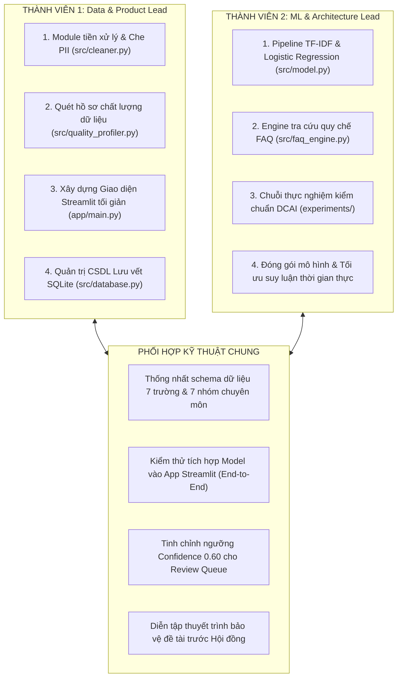

# EDUSUPPORTAI — HỆ THỐNG NÂNG CAO CHẤT LƯỢNG DỮ LIỆU & TỰ ĐỘNG PHÂN LOẠI PHẢN HỒI SINH VIÊN
## Đề tài Cuộc thi: Centric Data AI 2026 (Khoa CNTT — Trường Đại học Công nghệ Đông Á)
**Định vị phương pháp tiếp cận:** Data-Centric AI (DCAI) kết hợp Bàn làm việc kiểm duyệt con người (Human-in-the-Loop)

---

## 1. GIỚI THIỆU & ĐỊNH HƯỚNG PHÁT TRIỂN

**EduSupportAI** là giải pháp phần mềm chuyên sâu giải quyết bài toán tiếp nhận, chuẩn hóa, nâng cao chất lượng dữ liệu và tự động phân luồng phản ánh, thắc mắc của sinh viên trong môi trường đại học. Thay vì áp dụng các mô hình ngôn ngữ lớn (LLM) đắt đỏ, tiêu tốn phần cứng và tiềm ẩn rủi ro ảo giác thông tin (hallucination), hệ thống tập trung triệt để vào triết lý **Data-Centric AI**: *Tối ưu hóa chất lượng dữ liệu đầu vào để mang lại hiệu năng cao nhất trên một mô hình học máy nhẹ tải, minh bạch và an toàn.*

### QUYẾT ĐỊNH CHIẾN LƯỢC:
* **Không sử dụng số liệu khảo sát thủ công:** Dự án không sử dụng thời gian đi phát biểu mẫu Google Forms hay chờ đợi thu thập ý kiến bên ngoài.
* **Xây dựng hệ thống phân tích động trực tiếp:** Toàn bộ thống kê chất lượng dữ liệu (tỷ lệ rỗng, trùng lặp, thông tin định danh cá nhân PII) được tính toán theo thời gian thực trên dữ liệu nạp vào, không sử dụng số liệu giả định.
* **Tập trung 100% nguồn lực vào kỹ thuật AI & Phần mềm:** Triển khai ngay pipeline tiền xử lý, huấn luyện mô hình phân loại, engine tra cứu quy chế học vụ và ứng dụng Streamlit tối giản.

---

## 2. KIẾN TRÚC PHÂN TẦNG HỆ THỐNG (5 LAYERS)

Hệ thống được thiết kế theo kiến trúc phân tầng độc lập (Loose Coupling):

```mermaid
flowchart LR
    subgraph Layer1["1. TẦNG TIẾP NHẬN DỮ LIỆU"]
        direction TB
        L1_A["Tệp bảng tính thực tế (CSV / Excel)"]
        L1_B["Nhập câu hỏi trực tiếp trên Web"]
        L1_C["Dữ liệu kịch bản kiểm thử nội bộ"]
    end

    subgraph Layer2["2. ENGINE CHẤT LƯỢNG (DATA-CENTRIC)"]
        direction TB
        L2_A["Lọc câu rỗng & Độ dài < 12 ký tự"]
        L2_B["Chuẩn hóa Unicode NFC & Khoảng trắng"]
        L2_C["Che PII Regex: [PHONE], [EMAIL], [STUDENT_ID]"]
        L2_D["Khử trùng: Canonical Hash & SequenceMatcher"]
        L2_E["Gắn cờ quality_flags & Lọc is_usable"]
    end

    subgraph Layer3["3. LÕI MÁY HỌC & TRI THỨC"]
        direction TB
        L3_A["TF-IDF n-grams (word 1-2 & char 3-5)"]
        L3_B["Logistic Regression (L2, Multiclass)"]
        L3_C["Ước lượng độ tự tin (Confidence Score)"]
        L3_D["Cây quyết định ưu tiên: Khẩn cấp / Cao / Bình thường / Thấp"]
        L3_E["Tra cứu FAQ quy chế: Cosine Similarity (Mã KB)"]
    end

    subgraph Layer4["4. BÀN LÀM VIỆC CÁN BỘ (STREAMLIT)"]
        direction TB
        L4_A["Phân luồng Confidence (< 0.60 -> Review Queue)"]
        L4_B["Tự động sinh bản nháp kèm trích dẫn quy chế"]
        L4_C["Cơ chế duyệt 1 chạm: [Duyệt] [Đổi nhãn] [Từ chối]"]
        L4_D["Kiểm soát con người 100% (Human-in-the-Loop)"]
    end

    subgraph Layer5["5. ĐẦU RA & LƯU VẾT"]
        direction TB
        L5_A["Điều phối đúng 7 phòng ban chức năng"]
        L5_B["Dashboard phân tích chất lượng dữ liệu thực tế"]
        L5_C["Xuất tệp dữ liệu sạch (.csv đã che PII)"]
        L5_D["Lưu vết kiểm toán vào SQLite (review_logs)"]
    end

    Layer1 --> Layer2
    Layer2 --> Layer3
    Layer3 --> Layer4
    Layer4 --> Layer5
    Layer5 -.->|"Vòng lặp tái huấn luyện gia cường (Active Learning)"| Layer2
```



---

## 3. CẤU TRÚC THƯ MỤC DỰ ÁN

```text
EduSupportAI/
├── app/                            # Giao diện Streamlit (chỉ hiển thị, gọi src/service.py)
│   ├── main.py                     # Ghép 3 tab, nạp CSS và dịch vụ (khoảng 80 dòng)
│   ├── styles.css                  # Toàn bộ kiểu dáng giao diện
│   └── components/
│       ├── demo_guide.py           # Hướng dẫn nhanh và câu hỏi mẫu
│       ├── intake.py               # Form tiếp nhận, tự động duyệt, nạp tệp, email thử
│       ├── result_view.py          # Kết quả phân tích, phiếu ticket, tài liệu tham chiếu, bản nháp
│       ├── workbench.py            # Bàn duyệt cán bộ & Review Queue
│       └── dashboard.py            # Thống kê dữ liệu, kết quả thực nghiệm
├── src/                            # Lõi xử lý, không phụ thuộc giao diện
│   ├── config.py                   # Đường dẫn, ngưỡng, biến môi trường dùng chung
│   ├── service.py                  # Luồng xử lý một yêu cầu từ đầu đến cuối
│   ├── data_generator.py           # Module sinh dữ liệu kịch bản kiểm thử nội bộ
│   ├── cleaner.py                  # Pipeline làm sạch: Unicode NFC, Regex PII, Khử trùng lặp
│   ├── quality_profiler.py         # Quét chất lượng dữ liệu: rỗng, trùng lặp, cờ PII thực tế
│   ├── model.py                    # Trích xuất TF-IDF & Logistic Regression đa lớp
│   ├── faq_engine.py               # Engine tra cứu quy chế học vụ bằng Cosine Similarity
│   ├── procedure_engine.py         # Xử lý ticket theo quy trình: ghép quy trình, định tuyến, SLA, checklist
│   ├── local_llm.py                # Mô hình ngôn ngữ cục bộ (Ollama) + kiểm tra bám nguồn
│   └── database.py                 # Quản trị SQLite: bảng raw, processed, kb, review_logs
├── data/
│   ├── raw/                        # Dữ liệu kịch bản thô ban đầu
│   ├── processed/                  # Dữ liệu sạch sau tiền xử lý và che PII
│   ├── splits/                     # Tập Train / Val / Test_sealed
│   └── kb/
│       ├── eaut_faq_kb.csv         # Kho tri thức quy chế và câu hỏi FAQ mẫu EAUT
│       ├── eaut_quy_trinh.json     # 33 quy trình nghiệp vụ biên tập từ tài liệu hướng dẫn (CTSV, Đào tạo, CSVC)
│       └── procedure_eval.csv      # Tập câu hỏi diễn đạt lại để đánh giá định tuyến quy trình
├── models/
│   └── best_classifier.joblib      # Trọng số mô hình phân loại đã huấn luyện
├── experiments/
│   ├── run_experiments.py          # Chuỗi thực nghiệm E0 -> E3 (cũ, xem ghi chú trong SO_DO)
│   ├── run_group_holdout.py        # Đánh giá theo nhóm câu gốc (tránh rò rỉ mẫu câu)
│   ├── eval_procedure_routing.py   # Đánh giá định tuyến ticket theo quy trình
│   ├── eval_procedure_augmentation.py # Thực nghiệm bổ sung dữ liệu từ kho quy trình
│   └── error_analysis.py           # Phân tích các ca phân loại sai
├── tests/                          # Kiểm thử unittest (python -m unittest discover -s tests -t .)
├── images/                         # 6 sơ đồ kiến trúc hệ thống chuẩn 200 DPI
├── SO_DO_HE_THONG_EDUSUPPORT_AI.md # Sơ đồ kỹ thuật, Mermaid và số liệu thực nghiệm
├── DEMO_5_PHUT.md                  # Kịch bản demo và câu trả lời hội đồng
├── KE_HOACH_PHAT_TRIEN.md          # Kế hoạch phát triển tiếp theo
├── TODO.md                         # Bảng theo dõi tiến độ công việc
├── CHAY_DEMO_WINDOWS.bat           # Nhấp đúp để cài và chạy trên Windows
├── run_mvp.py                      # Chạy app (tự bật Ollama nếu có)
├── requirements.txt                # Thư viện cần để chạy
├── requirements-dev.txt            # Thêm công cụ kiểm tra lỗi (ruff) cho người phát triển
├── pyproject.toml                  # Cấu hình ruff
└── readme.md                       # Tài liệu này
```

---

## 4. PHÂN CÔNG CÔNG VIỆC NHÓM 2 NGƯỜI

Mô hình phân vai tối ưu hóa năng suất, tập trung 100% vào việc lập trình và kiểm chuẩn hệ thống AI:



| Tiêu chí | Thành viên 1: Data & Product Lead | Thành viên 2: ML & Architecture Lead |
| :--- | :--- | :--- |
| **Phạm vi phụ trách** | **Data Ingestion -> Cleaner -> Streamlit App -> SQLite DB** | **Feature Engineering -> ML Model -> FAQ Engine -> DCAI Benchmark** |
| **Code chính** | • `src/cleaner.py`<br>• `src/quality_profiler.py`<br>• `src/database.py`<br>• `app/main.py`<br>• `app/components/` | • `src/model.py`<br>• `src/faq_engine.py`<br>• `experiments/run_experiments.py`<br>• `experiments/error_analysis.py`<br>• `models/best_classifier.joblib` |
| **Nhiệm vụ trọng tâm** | • Viết Regex che giấu PII (SĐT, Email, MSSV).<br>• Lập trình giao diện 3 tab tối giản không emoji.<br>• Phân tích thống kê chất lượng dữ liệu thực tế.<br>• Xử lý bảng `review_logs` lưu vết kiểm toán. | • Trích xuất đặc trưng TF-IDF word 1-2 & char 3-5.<br>• Huấn luyện Logistic Regression đa lớp.<br>• Xây dựng module Cosine Similarity tra cứu FAQ.<br>• Chạy kiểm chuẩn trên tập dữ liệu kiểm thử niêm phong. |

---

## 5. ĐẶC TẢ CÁC MODULE KỸ THUẬT CỐT LÕI

### Module 1: Tiền xử lý & Bảo mật PII (`src/cleaner.py`)
* **Lọc ngắn:** Gắn cờ `too_short`, `is_usable = False` nếu `len(text) < 12`.
* **Chuẩn hóa Unicode:** Áp dụng `unicodedata.normalize('NFC', text)` đồng nhất font tiếng Việt.
* **Regex che giấu PII:**
  - Số điện thoại: `r'(\b0[3|5|7|8|9][0-9]{8}\b)'` -> `[PHONE]`
  - Email: `r'([a-zA-Z0-9_.+-]+@[a-zA-Z0-9-]+\.[a-zA-Z0-9-.]+)'` -> `[EMAIL]`
  - Mã sinh viên: `r'(\b(20[0-9]{6}|[0-9]{8,10})\b)'` -> `[STUDENT_ID]`
* **Khử trùng lặp:** Băm MD5 Canonical text để lọc trùng 100%; dùng `difflib.SequenceMatcher(ratio >= 0.93)` gắn cờ `near_duplicate`.

### Module 2: Thống kê & Quét chất lượng dữ liệu (`src/quality_profiler.py`)
* Phân tích trực tiếp từ dữ liệu thực tế (DataFrame hoặc tệp tải lên):
  - Số dòng tiếp nhận, số dòng hợp lệ.
  - Số dòng rỗng, số dòng quá ngắn.
  - Số dòng trùng lặp thực tế.
  - Số dòng chứa thông tin định danh cá nhân nhạy cảm (SĐT, Email, MSSV).
  - Phân bổ độ dài ký tự và phân bổ theo 7 nhóm chuyên môn tiếp nhận.

### Module 3: Lõi Máy học & Phân luồng (`src/model.py`)
* **Trích xuất đặc trưng:**
  - `TfidfVectorizer(ngram_range=(1, 2), min_df=1, sublinear_tf=True)` cho cấp độ từ.
  - `TfidfVectorizer(analyzer='char_wb', ngram_range=(3, 5), min_df=1, sublinear_tf=True)` bắt lỗi gõ và teencode.
* **Thuật toán phân loại:** `LogisticRegression(C=1.5, solver='lbfgs', class_weight='balanced')`.
* **Ước lượng Confidence:** `confidence_score = max(predict_proba)`.
* **Cây quyết định ưu tiên nghiệp vụ:**
  - `Khẩn cấp`: Chứa từ khóa ("đình chỉ", "sai điểm", "tai nạn", "hết hạn hôm nay", "nghẽn mạng", "nhập viện").
  - `Cao`: Chứa từ khóa ("gia hạn", "phúc khảo", "không thi được", "khóa cửa", "hỏng", "rút hồ sơ").
  - `Bình thường`: Câu hỏi học vụ tiêu chuẩn.
  - `Thấp`: Góp ý cơ sở vật chất, câu lạc bộ, xe đưa đón.

### Module 4: Engine Tri thức & Gợi ý bản nháp (`src/faq_engine.py`)
* Kho FAQ `data/kb/eaut_faq_kb.csv` gồm 15 mục (`KB001` đến `KB015`): 5 mục (KB002, KB009, KB010, KB011, KB012) đã đối chiếu và sửa theo tài liệu quy trình của trường (`verified=true`, có nguồn); 10 mục còn lại là nội dung minh họa, chưa xác minh.
* Câu hỏi thuộc 33 quy trình nghiệp vụ được xử lý trước bằng `src/procedure_engine.py` (xem mục 8); FAQ chỉ dùng khi không khớp quy trình.
* Vector hóa nội dung bằng TF-IDF và tính `cosine_similarity(query_vec, kb_vecs)`.
* Tự động trích dẫn điều khoản phù hợp và ghép thành bản nháp phản hồi đầy đủ cấu trúc gửi sinh viên.

### Module 5: Ứng dụng Bàn làm việc Streamlit (`app/main.py`)
* **Giao diện tối giản (Không Emoji):** Thiết kế thanh lịch, chuyên nghiệp, tập trung vào dữ liệu và nghiệp vụ.
* **Tab 1 (Xử lý phản ánh):** Nhập câu hỏi đơn lẻ hoặc chọn câu mẫu; phân tích tức thì ra bản đã che PII, nhãn chuyên môn, mức ưu tiên và bản nháp phản hồi; có tùy chọn nạp hàng loạt vào CSDL.
* **Tab 2 (Bàn duyệt cán bộ - Review Queue):** Lọc các ca `confidence < 0.60` hoặc có cờ cảnh báo; hiển thị so sánh trước/sau; 3 nút thao tác 1 chạm (`Duyệt & Gửi`, `Đổi nhãn & Duyệt`, `Từ chối / Spam`).
* **Tab 3 (Thống kê & Dữ liệu thực tế):**
  - Tải lên tệp bảng tính thực tế (.xlsx hoặc .csv) để quét phân tích chất lượng động 100%.
  - Hoặc xem thống kê từ CSDL SQLite tiếp nhận thực tế.
  - Xuất tệp dữ liệu đã làm sạch và sổ cái nhật ký kiểm toán cán bộ.

---

## 6. HƯỚNG DẪN CÀI ĐẶT & KHỞI CHẠY

**Cách nhanh nhất (Windows):** nhấp đúp `CHAY_DEMO_WINDOWS.bat`. Lần đầu tự tạo `.venv` và cài thư viện (cần Internet), sau đó mở `http://127.0.0.1:8501`.

### Bước 1: Khởi tạo môi trường ảo & Cài đặt thư viện (Python 3.12)
```bash
# Windows
py -3.12 -m venv .venv
.venv\Scripts\activate
# macOS / Linux
python3.12 -m venv .venv
source .venv/bin/activate

pip install -r requirements.txt
```

### Bước 2: Khởi chạy ứng dụng
```bash
python run_mvp.py
```
Truy cập `http://127.0.0.1:8501`. `run_mvp.py` tự bật Ollama nếu đã cài (xem mục 8.3); không có Ollama thì bản nháp dùng mẫu câu.
CSDL `data/edusupport.db` được tạo rỗng ở lần chạy đầu; nạp dữ liệu mẫu ở tab **Dữ liệu và lịch sử**.

### Bước 3: Kiểm thử và thực nghiệm (tùy chọn)
```bash
python -m unittest discover -s tests -t .          # toàn bộ kiểm thử
python -m src.model                                 # huấn luyện lại mô hình phân loại
python -m experiments.eval_procedure_routing        # đánh giá định tuyến quy trình
python -m experiments.eval_procedure_augmentation   # thực nghiệm bổ sung dữ liệu
python demo_live.py                                 # demo dòng lệnh 5 tình huống
```

---

## 7. QUY CHUẨN ĐÓNG GÓI & TÀI LIỆU NỘP BÀI DỰ THI
* **Tệp dữ liệu kiểm thử thực tế EAUT:** [`data/mau_phan_anh_thuc_te_eaut.csv`](data/mau_phan_anh_thuc_te_eaut.csv) (50 phản ánh thực tế đa dạng chủ đề, nhiễu PII, trùng lặp, tin rác và cấp độ ưu tiên).
* **Kịch bản chạy Demo tự động:** [`demo_live.py`](demo_live.py) (kiểm thử 5 tình huống thực tế đầu cuối: che PII, phân loại, tra cứu quy chế, duyệt cán bộ và quét hồ sơ dữ liệu).
* **Thuyết minh và kế hoạch ban đầu:** thư mục [`../docs`](../docs) (thuyết minh bước đầu, phân tích và kế hoạch, phân công nhóm).
* **Tài liệu hệ thống sơ đồ kỹ thuật & Mermaid:** [`SO_DO_HE_THONG_EDUSUPPORT_AI.md`](SO_DO_HE_THONG_EDUSUPPORT_AI.md).
* **Kế hoạch phát triển tiếp theo:** [`KE_HOACH_PHAT_TRIEN.md`](KE_HOACH_PHAT_TRIEN.md) (lộ trình chi tiết 4 Sprint nâng cấp hệ thống).
* **Bảng theo dõi tiến độ công việc:** [`TODO.md`](TODO.md) (checklist tương tác phân vai chi tiết cho 2 thành viên).
* **Mã nguồn dự án:** Sẵn sàng đẩy lên GitHub theo cấu trúc quy chuẩn mô-đun hóa độc lập.

---

## 8. XỬ LÝ TICKET THEO QUY TRÌNH NGHIỆP VỤ & MÔ HÌNH NGÔN NGỮ CỤC BỘ

### 8.1. Luồng xử lý một ticket
```text
Câu hỏi sinh viên
 -> cleaner (NFC, che PII)            -> model (7 nhóm + confidence)
 -> procedure_engine: ghép 1 trong 33 quy trình (TF-IDF từ + ký tự trên văn bản bỏ dấu, có cổng từ khóa neo)
      có quy trình  -> Phiếu xử lý: đơn vị đầu mối, điều kiện, hồ sơ, các bước - đơn vị - thời gian,
                       hạn xử lý dự kiến (ngày làm việc), thông tin còn thiếu (VD: chưa có MSSV)
                    -> local_llm (Ollama, qwen2.5:3b) soạn bản nháp CHỈ từ nội dung quy trình
                    -> kiểm tra bám nguồn: số, mã biểu mẫu, số quyết định phải có trong quy trình;
                       vi phạm -> loại bản LLM, dùng bản nháp theo mẫu + cảnh báo cán bộ
      không có      -> giữ luồng FAQ cũ (tài liệu minh họa, cán bộ xác minh)
 -> Bàn duyệt cán bộ (bản nháp do LLM soạn luôn qua cán bộ duyệt, không tự động gửi)
```

### 8.2. Kho quy trình `data/kb/eaut_quy_trinh.json`
Biên tập từ 3 tài liệu hướng dẫn: quy trình nghiệp vụ CTSV, quy trình quản lý đào tạo, quy trình CSVC.
Gồm chuyển ngành, chuyển trường (đến/đi), bảo lưu, học tiếp, thôi học, buộc thôi học, học lại/cải thiện,
giao và bảo vệ ĐA/KLTN, giấy xác nhận SV, thẻ SV, hiệu chỉnh hồ sơ, bảng điểm, bản sao bằng, đối soát học phí,
kỷ luật, miễn giảm học phí, tạm hoãn NVQS, vay vốn, điểm rèn luyện, rút học phần, chuyển đổi tín chỉ,
hồ sơ nhập học, GDQP-AN, mượn phòng, thiết bị phòng học, sự cố thiết bị, thư viện số, mượn/trả/phạt sách,
máy tính thư viện, phòng thực hành. Mỗi quy trình có `keywords` (từ khóa neo) và `aliases` (câu hỏi mẫu).

### 8.3. Cài mô hình ngôn ngữ cục bộ (một lần, cần Internet)
```bash
winget install --id Ollama.Ollama -e
ollama pull qwen2.5:3b
```
Sau đó chạy app như bình thường; app tự phát hiện Ollama tại `http://127.0.0.1:11434` và chạy offline.
Biến môi trường: `EDUSUPPORT_LLM=off` (tắt LLM), `EDUSUPPORT_LLM_MODEL` (đổi model, VD `qwen2.5:1.5b` cho máy yếu),
`OLLAMA_HOST`, `EDUSUPPORT_LLM_TIMEOUT`. Không có Ollama thì hệ thống vẫn chạy bằng bản nháp theo mẫu.

### 8.4. Đánh giá định tuyến quy trình
```bash
python -m experiments.eval_procedure_routing
```
Tập `procedure_eval.csv` gồm 30 câu trong phạm vi và 10 câu ngoài phạm vi, viết khác câu mẫu trong kho.
Kết quả hiện tại: ghép đúng 28/30 (93,3%), từ chối đúng 10/10. Tập do nhóm tự viết, còn nhỏ, chưa đại diện
câu hỏi thực tế; không chỉnh từ khóa theo tập này để tránh rò rỉ đánh giá.

### 8.5. Bổ sung dữ liệu huấn luyện từ kho quy trình
`python -m src.model` huấn luyện lại mô hình với 136 câu mô phỏng gốc cộng 183 câu mẫu của 33 quy trình
(cùng thuật toán). So sánh trước/sau: `python -m experiments.eval_procedure_augmentation`
(kết quả trong `experiments/procedure_augmentation_report.json` và trong app, tab Dữ liệu và lịch sử).
Khi độ tự tin dưới 60% mà đã khớp quy trình qua từ khóa neo, hệ thống dùng nhóm chủ đề của quy trình và ghi lại nhóm mô hình gợi ý.
`run_mvp.py` tự bật Ollama nếu đã cài.
