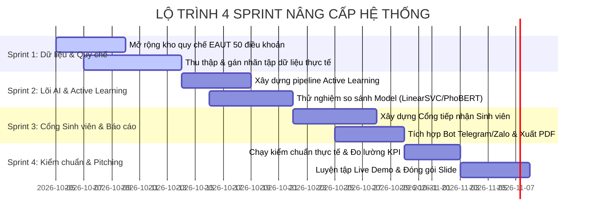

# KẾ HOẠCH PHÁT TRIỂN & TODO LIST DỰ ÁN EDUSUPPORTAI
## Đề tài Cuộc thi: Centric Data AI 2026 — Khoa CNTT, Trường Đại học Công nghệ Đông Á (EAUT)
**Phương pháp tiếp cận:** Data-Centric AI (DCAI) kết hợp Bàn làm việc kiểm duyệt con người (Human-in-the-Loop)

---

## 1. TỔNG QUAN NỀN TẢNG ĐÃ ĐẠT ĐƯỢC (BASELINE ASSETS)

Hệ thống đã hoàn thành giai đoạn khởi dựng nền tảng (Foundation & Pre-development PoC) và được đẩy mã nguồn hoàn chỉnh lên GitHub:

- **Văn bản thuyết minh chính thức:** `KCNTT_Mau thuyet minh vong 1.docx` (1.6 MB, tích hợp 14 bảng biểu, 6 sơ đồ kiến trúc 200 DPI).
- **Lõi tiền xử lý & Bảo mật PII:** `src/cleaner.py` (chuẩn hóa Unicode NFC, khử trùng MD5 & SequenceMatcher, che giấu an toàn `[PHONE]`, `[EMAIL]`, `[STUDENT_ID]`).
- **Lõi phân loại & Engine Quy chế:** `src/model.py` (TF-IDF kép word/char, Logistic Regression đa lớp) và `src/faq_engine.py` (Cosine Similarity 15 điều khoản EAUT, tự sinh bản nháp trích dẫn điều khoản).
- **Bàn làm việc cán bộ:** `app/main.py` (Streamlit 3 tab tối giản không emoji, cơ chế duyệt 1 chạm và ghi vết SQLite audit logs).
- **Hệ thống phân tích động:** `app/components/dashboard.py` (phân tích động 100% từ tệp CSV/Excel tải lên hoặc SQLite, không bịa đặt số liệu).

---

## 2. LỘ TRÌNH 4 SPRINT PHÁT TRIỂN TIẾP THEO

---

## 3. PHÂN CÔNG VAI TRÒ NHÓM 2 NGƯỜI

| Thành viên | Vai trò chính | Trách nhiệm kỹ thuật trọng tâm |
| :--- | :--- | :--- |
| **Thành viên 1** | **Data & Product Lead** | • Thu thập, chuẩn hóa và bảo mật tập dữ liệu sinh viên thực tế. • Mở rộng kho quy chế EAUT từ 15 lên 50+ điều khoản. • Lập trình giao diện Cổng tiếp nhận Sinh viên và tính năng tra cứu Ticket. • Phân tích nghiệp vụ, thiết kế Slide thuyết trình và kịch bản Demo. |
| **Thành viên 2** | **ML & Architecture Lead** | • Xây dựng vòng lặp Active Learning tự động học từ SQLite `review_logs`. • Tối ưu hóa bộ trích xuất đặc trưng và thử nghiệm mô hình nâng cao. • Lập trình Webhook tiếp nhận bot tự động (Telegram / Zalo). • Thực thi chuỗi thực nghiệm kiểm chuẩn, đo độ trễ và khả năng chịu tải. |

---

## 4. BẢNG TODO LIST CHI TIẾT THEO SPRINT

### SPRINT 1: MỞ RỘNG DỮ LIỆU THỰC TẾ & KHO TRI THỨC QUY CHẾ (TUẦN 1)
*Mục tiêu: Đưa dữ liệu thực tế của EAUT vào hệ thống và hoàn thiện kho tri thức quy chế bao quát toàn trường.*

- [ ] **Mở rộng kho tri thức quy chế lên 50 điều khoản**
  - **Phụ trách:** Thành viên 1
  - **Mô tả:** Khảo sát các văn bản quy định của EAUT, bổ sung 35 điều khoản mới vào `data/kb/eaut_faq_kb.csv` (Quy chế tính điểm GPA, học bổng khuyến khích, cảnh báo học vụ, chuẩn đầu ra ngoại ngữ/tin học, điều kiện thực tập doanh nghiệp).
  - **Đầu ra:** Tệp `data/kb/eaut_faq_kb.csv` gồm $\ge 50$ bản ghi chuẩn hóa có mã từ `KB001` đến `KB050`.

- [ ] **Thu thập log câu hỏi thực tế ẩn danh tại EAUT**
  - **Phụ trách:** Cả 2 thành viên
  - **Mô tả:** Xin mẫu câu hỏi/thắc mắc ẩn danh từ Văn phòng Khoa CNTT, Cổng một cửa tiếp nhận hoặc Group Zalo/Facebook sinh viên các khóa K12–K15.
  - **Đầu ra:** Tệp dữ liệu thô ban đầu `data/raw/eaut_real_queries_raw.csv`.

- [ ] **Nâng cấp bộ lọc PII cho văn phong tiếng Việt tự do**
  - **Phụ trách:** Thành viên 2
  - **Mô tả:** Mở rộng regex trong `src/cleaner.py` để nhận diện các biến thể gõ số điện thoại có dấu cách (`0987 654 321`), email sinh viên nhiều định dạng và các tiền tố xưng hô.
  - **Đầu ra:** Hàm `mask_pii()` che phủ $\ge 98\%$ các ca PII thực tế.

- [ ] **Biên soạn Quy chuẩn gán nhãn (Annotation Guideline) & Gán nhãn chéo**
  - **Phụ trách:** Thành viên 1 chủ trì, Thành viên 2 phản biện
  - **Mô tả:** Viết tài liệu quy chuẩn phân loại 7 nhóm chuyên môn; 2 người gán nhãn độc lập trên 100 mẫu đầu tiên để đo chỉ số đồng thuận liên người đánh giá (**Cohen's Kappa $\ge 0.85$**).
  - **Đầu ra:** Tài liệu `docs/annotation_guidelines.md` và tập dữ liệu gán nhãn chuẩn `data/processed/eaut_labeled_data.csv`.

- [ ] **Phân chia và niêm phong tập kiểm chuẩn thực tế (Sealed Test Set)**
  - **Phụ trách:** Thành viên 2
  - **Mô tả:** Tách và niêm phong tập Test Set thực tế phân tầng đều 7 nhóm chuyên môn để dùng cố định cho các mốc đánh giá sau này.
  - **Đầu ra:** Tệp `data/splits/test_real_sealed.csv`.

---

### SPRINT 2: VÒNG LẶP ACTIVE LEARNING & TỐI ƯU HÓA LÕI HỌC MÁY (TUẦN 2)
*Mục tiêu: Xây dựng cơ chế tự động học từ thao tác hiệu chỉnh của cán bộ và nâng cao độ chính xác phân loại.*

- [ ] **Lập trình Module Active Learning từ SQLite**
  - **Phụ trách:** Thành viên 2
  - **Mô tả:** Viết module `src/active_learning.py` tự động trích xuất các ca cán bộ bấm `Đổi nhãn & Duyệt` (`officer_action = 'edit_label'`) từ bảng `review_logs` để bổ sung vào tập huấn luyện gia cường.
  - **Đầu ra:** Script `src/active_learning.py` hoạt động độc lập và có hàm `export_retrain_pool()`.

- [ ] **Thiết lập nút Tái huấn luyện 1 chạm trên Bàn làm việc**
  - **Phụ trách:** Thành viên 1
  - **Mô tả:** Tích hợp nút `Tái huấn luyện mô hình từ dữ liệu đã duyệt` trên giao diện Streamlit `app/components/workbench.py`, hiển thị số lượng ca mới đã học được.
  - **Đầu ra:** Giao diện hỗ trợ kích hoạt tái huấn luyện trực tiếp không cần can thiệp command line.

- [ ] **Thực nghiệm đối chuẩn các bộ phân loại nâng cao**
  - **Phụ trách:** Thành viên 2
  - **Mô tả:** So sánh hiệu năng giữa `LogisticRegression`, `LinearSVC (SGDClassifier)` và `LightGBM` trên tập kiểm thử niêm phong thực tế về cả Macro F1 lẫn thời gian suy luận (Latency $\le 50$ms trên CPU).
  - **Đầu ra:** Báo cáo so sánh `experiments/model_benchmark_comparison.json`.

- [ ] **Tối ưu hóa Engine tra cứu quy chế học vụ**
  - **Phụ trách:** Thành viên 2
  - **Mô tả:** Nâng cấp `src/faq_engine.py` kết hợp TF-IDF với thuật toán tìm kiếm từ khóa trọng yếu (BM25 scoring) để tăng độ chính xác tìm điều khoản quy chế lên $> 90\%$.
  - **Đầu ra:** Bản nháp câu trả lời trích dẫn điều khoản chính xác và sát thực tế hơn.

---

### SPRINT 3: CỔNG TIẾP NHẬN SINH VIÊN & BÁO CÁO QUẢN TRỊ (TUẦN 3)
*Mục tiêu: Hoàn thiện luồng tương tác 2 đầu (Sinh viên gửi - Cán bộ duyệt) và module báo cáo cấp trường.*

- [ ] **Xây dựng Cổng tiếp nhận Sinh viên độc lập (Student Portal Webform)**
  - **Phụ trách:** Thành viên 1
  - **Mô tả:** Thiết kế giao diện webform dành riêng cho sinh viên (tối giản, tương thích điện thoại di động): nhập câu hỏi, tự động sinh mã phiếu tiếp nhận (`Ticket ID dạng EAUT-2026-XXXX`).
  - **Đầu ra:** Phân hệ `app/student_portal.py` hoặc tab riêng biệt cho sinh viên.

- [ ] **Tính năng tra cứu trạng thái phản ánh theo mã Ticket**
  - **Phụ trách:** Thành viên 1
  - **Mô tả:** Sinh viên nhập mã Ticket ID để xem trạng thái: `Đang xử lý`, `Đã có câu trả lời từ phòng ban`, và xem nội dung phản hồi chính thức.
  - **Đầu ra:** Trang tra cứu tiến độ hoạt động trực tiếp dựa trên SQLite `processed_requests`.

- [ ] **Tích hợp Webhook tiếp nhận tự động (Telegram Bot / Zalo)**
  - **Phụ trách:** Thành viên 2
  - **Mô tả:** Xây dựng script bot Telegram/Zalo tiếp nhận tin nhắn sinh viên, tự động gọi pipeline làm sạch che PII và đẩy thẳng vào hàng đợi `processed_requests` để cán bộ xử lý.
  - **Đầu ra:** Module `src/bot_webhook.py` kết nối thành công bot tiếp nhận.

- [ ] **Module Xuất báo cáo quản trị cấp trường (Executive Analytics)**
  - **Phụ trách:** Cả 2 thành viên (TV1 làm giao diện, TV2 xử lý xuất file)
  - **Mô tả:** Thống kê các vấn đề nóng theo tuần/tháng, tỷ lệ phân bổ phản ánh theo từng phòng ban chức năng; nút bấm xuất báo cáo tổng hợp dạng PDF/Excel có biểu đồ phục vụ Ban Giám hiệu.
  - **Đầu ra:** Tính năng tải báo cáo quản trị tại Tab `Thống kê & Dữ liệu`.

---

### SPRINT 4: KIỂM CHUẨN TOÀN DIỆN, ĐÓNG GÓI SLIDE & LIVE DEMO (TUẦN 4)
*Mục tiêu: Đóng gói toàn bộ sản phẩm, đo đạc chỉ số KPI thực tế và chuẩn bị diễn tập bảo vệ trước Hội đồng Giám khảo.*

- [ ] **Đo lường KPI thực nghiệm toàn diện trên Test Set thực tế**
  - **Phụ trách:** Thành viên 2
  - **Mô tả:** Chạy chuỗi thực nghiệm chính thức, ghi nhận chính xác các chỉ số: Macro F1, Weighted F1, Accuracy, Ma trận nhầm lẫn (Confusion Matrix), Độ trễ trung bình (Latency per query), Thông lượng (Throughput req/sec).
  - **Đầu ra:** Tệp báo cáo kỹ thuật `experiments/final_kpi_evaluation_report.json`.

- [ ] **Kiểm thử tải (Stress Testing) và Chạy Offline hoàn toàn**
  - **Phụ trách:** Thành viên 2
  - **Mô tả:** Đảm bảo toàn bộ hệ thống (Streamlit, Model, SQLite, FAQ Engine) có thể khởi chạy và hoạt động trơn tru cục bộ trên máy tính xách tay không cần kết nối mạng Internet (tránh rủi ro mất mạng khi thuyết trình).
  - **Đầu ra:** Môi trường diễn tập Demo độc lập 100% offline.

- [ ] **Kịch bản Demo trực tiếp 5 phút (Live Demo Storyboard)**
  - **Phụ trách:** Cả 2 thành viên
  - **Mô tả:** Xây dựng kịch bản 5 phút phân vai rõ ràng:
    - *Phút 1 (TV1):* Sinh viên gửi câu hỏi có lỗi gõ, teencode và số điện thoại/MSSV cá nhân.
    - *Phút 2 (TV2):* Hệ thống tiền xử lý che PII an toàn, phân loại đúng phòng ban và trích dẫn điều khoản quy chế EAUT.
    - *Phút 3 (TV1):* Cán bộ thao tác 1 chạm duyệt gửi phản hồi trên Review Queue.
    - *Phút 4 (TV2):* Tải lên tệp Excel 50 câu hỏi thực tế, Dashboard hiển thị phân tích chất lượng dữ liệu động tức thì.
    - *Phút 5 (Cả 2):* Minh chứng cơ chế Active Learning tự động học từ ca hiệu chỉnh của cán bộ.
  - **Đầu ra:** Tài liệu kịch bản `docs/live_demo_storyboard.md`.

- [ ] **Thiết kế Slide thuyết trình chuyên nghiệp (Pitch Deck)**
  - **Phụ trách:** Thành viên 1
  - **Mô tả:** Soạn bộ Slide bảo vệ đề tài (15–18 slides) chuẩn màu nhận diện EAUT (Xanh dương & Cam), tập trung làm nổi bật: Vấn đề nhức nhối tại trường đại học $\rightarrow$ Tiếp cận Data-Centric AI $\rightarrow$ Demo sản phẩm $\rightarrow$ Hiệu quả giảm tải thực tế cho cán bộ.
  - **Đầu ra:** Tệp Slide trình chiếu `EduSupportAI_Pitch_Deck_Centric_AI_2026.pptx` (hoặc PDF).

- [ ] **Quay video clip giới thiệu sản phẩm (3 phút)**
  - **Phụ trách:** Cả 2 thành viên
  - **Mô tả:** Quay video màn hình chất lượng cao kèm thuyết minh tóm tắt luồng hoạt động chính của EduSupportAI để nộp kèm hồ sơ cuộc thi và dự phòng trường hợp thiết bị gặp sự cố.
  - **Đầu ra:** Video clip `EduSupportAI_Demo_Video_3Min.mp4`.

---

## 5. MA TRẬN CHỈ SỐ KPI NGHIỆM THU

| Chỉ số kỹ thuật | Mức cơ sở (PoC Vòng 1) | Mục tiêu nghiệm thu Chung kết | Phương pháp kiểm chứng |
| :--- | :---: | :---: | :--- |
| **Độ phủ Tri thức quy chế** | 15 điều khoản | **$\ge$ 50 điều khoản** | Truy vấn trong bảng `knowledge_base` |
| **Độ chính xác che giấu PII** | 100% trên mẫu regex | **$\ge$ 98%** trên dữ liệu gõ tự do thực tế | Kiểm thử trên tập PII gán nhãn thực tế |
| **Hiệu năng phân loại (Macro F1)** | Đo trên dữ liệu kịch bản | **$\ge$ 0.82 – 0.85** | Script `experiments/run_experiments.py` |
| **Tốc độ suy luận (Latency)** | ~30 ms / câu hỏi | **$\le$ 50 ms / câu hỏi** (chạy CPU thường) | Đo thời gian trung bình qua 100 câu hỏi |
| **Tỷ lệ giảm tải cho cán bộ** | Giảm thao tác thủ công | **Tự động hóa $\ge$ 65%** câu hỏi học vụ chuẩn | Thống kê số ca duyệt không cần sửa nhãn |
| **Tính khả dụng ngoại tuyến** | Cần Internet một phần | **100% Offline** (không cần Internet khi Demo) | Kiểm thử ngắt mạng toàn bộ hệ thống |
