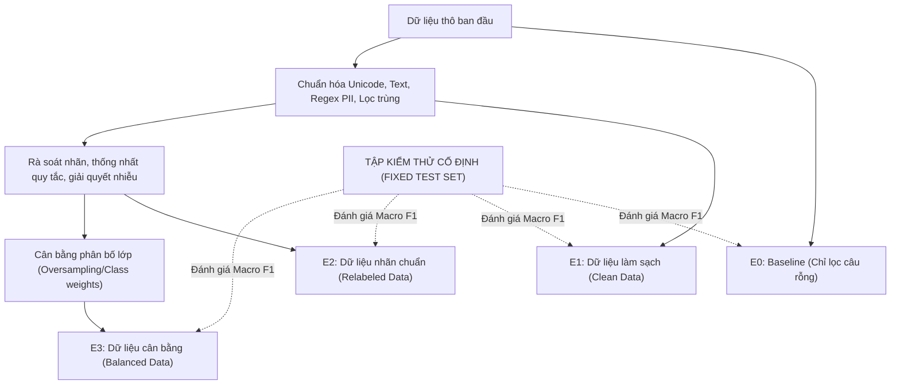
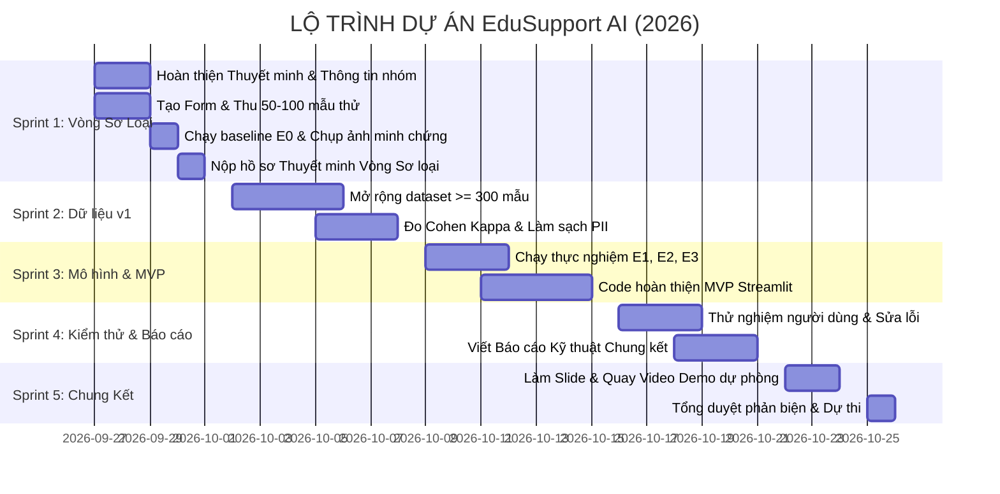

# BẢN PHÂN TÍCH THUYẾT MINH & KẾ HOẠCH HÀNH ĐỘNG DỰ ÁN
## Dự án: EduSupport AI - Hệ thống nâng cao chất lượng dữ liệu và tự động phân loại phản hồi sinh viên
**Cuộc thi:** Centric Data AI 2026 (Khoa CNTT - Trường Đại học Công nghệ Đông Á)  
**Ngày phân tích:** 27/09/2026  
**Tài liệu gốc:** `EduSupport_AI_Thuyet_minh_buoc_dau.docx`

---

## MỤC LỤC
1. [TỔNG QUAN DỰ ÁN & ĐỊNH VỊ DATA-CENTRIC AI](#1-tổng-quan-dự-án--định-vị-data-centric-ai)
2. [PHÂN TÍCH CHUYÊN SÂU NỘI DUNG THUYẾT MINH](#2-phân-tích-chuyên-sâu-nội-dung-thuyết-minh)
   - 2.1. Vấn đề thực tế và câu hỏi nghiên cứu
   - 2.2. Khung tiêu chí đánh giá cuộc thi
   - 2.3. Thiết kế dữ liệu & Bảo vệ quyền riêng tư (PII)
   - 2.4. Thiết kế thí nghiệm Data-Centric (E0 – E3)
   - 2.5. Kiến trúc kỹ thuật & 7 chức năng cốt lõi MVP (F01 – F07)
   - 2.6. Quản trị rủi ro & Pháp lý thể lệ
3. [GAP ANALYSIS - KHOẢNG TRỐNG CẦN BỔ SUNG NGAY](#3-gap-analysis---khoảng-trống-cần-bổ-sung-ngay)
4. [KẾ HOẠCH HÀNH ĐỘNG CHI TIẾT (ACTION PLAN 27/09 - 26/10/2026)](#4-kế-hoạch-hành-động-chi-tiết-action-plan-2709---26102026)
   - 4.1. Sprint 1 (27/09 - 01/10): Nước rút nộp Thuyết minh Vòng Sơ loại
   - 4.2. Sprint 2 (02/10 - 08/10): Xây dựng Dataset v1 & Pipeline làm sạch
   - 4.3. Sprint 3 (09/10 - 15/10): Thí nghiệm E1-E3 & Hoàn thiện ứng dụng Streamlit
   - 4.4. Sprint 4 (16/10 - 21/10): Kiểm thử, Dashboard phân tích & Hồ sơ chung kết
   - 4.5. Sprint 5 (22/10 - 26/10): Đóng gói Demo, Slide & Luyện tập thuyết trình
5. [THIẾT KẾ CẤU TRÚC KHO MÃ NGUỒN (REPOSITORY STRUCTURE)](#5-thiết-kế-cấu-trúc-kho-mã-nguồn-repository-structure)
6. [PHÂN CÔNG NHIỆM VỤ (MA TRẬN RACI)](#6-phân-công-nhiệm-vụ-ma-trận-raci)

---

## 1. TỔNG QUAN DỰ ÁN & ĐỊNH VỊ DATA-CENTRIC AI

### 1.1. Bản chất cốt lõi của đề tài
* **Tên đề tài:** EduSupport AI – Hệ thống nâng cao chất lượng dữ liệu và tự động phân loại phản hồi sinh viên.
* **Lĩnh vực:** Giáo dục và cộng đồng.
* **Định vị tiếp cận:** **Data-Centric AI (DCAI)**. Đề tài **không** cố gắng xây dựng mô hình Deep Learning phức tạp, không train mô hình ngôn ngữ lớn (LLM) từ đầu. Thay vào đó, trọng tâm tuyệt đối nằm ở:
  1. Xây dựng bộ quy chuẩn và chỉ số đo lường chất lượng dữ liệu (Data Quality Profile).
  2. Xây dựng pipeline tiền xử lý: phát hiện lỗi, khử trùng lặp (deduplication), chuẩn hóa chính tả/Unicode tiếng Việt, làm sạch và che giấu thông tin định danh cá nhân (PII Masking).
  3. Xây dựng quy trình gán nhãn có kiểm soát độ tin cậy (Inter-annotator agreement - Cohen's Kappa).
  4. Thực nghiệm khoa học chứng minh: **Cùng một mô hình cơ sở đơn giản (TF-IDF + Logistic Regression / Linear SVM), chất lượng dữ liệu tăng lên sẽ trực tiếp làm tăng độ chính xác (Macro F1) và độ ổn định phân loại.**

---

## 2. PHÂN TÍCH CHUYÊN SÂU NỘI DUNG THUYẾT MINH

### 2.1. Vấn đề thực tế và câu hỏi nghiên cứu
* **Thực trạng tại trường đại học:** Phản hồi của sinh viên gửi qua nhiều kênh (biểu mẫu, email, mạng xã hội) ở dạng phi cấu trúc. Người phụ trách phải đọc thủ công từng ý kiến, dễ nhầm lẫn, chậm trễ điều phối tới phòng ban chức năng.
* **Vấn đề dữ liệu:**
  - Bản ghi rỗng, cộc lốc, không có ngữ cảnh để phân loại.
  - Phản hồi trùng lặp hoặc spam.
  - Chứa PII nhạy cảm: Họ tên, Số điện thoại, Email, Mã số sinh viên (MSSV).
  - Lỗi gõ tiếng Việt, teencode, viết tắt, không dấu.
  - Dữ liệu bị mất cân bằng trầm trọng (imbalanced classes) giữa các nhóm vấn đề.
* **Câu hỏi nghiên cứu:**  
  *“Việc áp dụng một quy trình kiểm soát chất lượng dữ liệu có làm tăng độ chính xác và độ ổn định của mô hình phân loại phản hồi sinh viên so với việc huấn luyện trực tiếp trên dữ liệu thô hay không?”*
* **Giả thuyết khoa học:**  
  Sau khi chuẩn hóa, khử trùng, thống nhất nhãn và giảm mất cân bằng lớp, mô hình đạt **Macro F1 cao hơn** trên cùng một tập kiểm thử cố định (Fixed Test Set).

### 2.2. Khung tiêu chí đánh giá cuộc thi

| Vòng thi | Tiêu chí | Trọng số | Yêu cầu bằng chứng cần chuẩn bị |
| :--- | :--- | :---: | :--- |
| **Sơ loại** | Ý tưởng & Tiềm năng | 25đ | Mô tả rõ quy trình hiện tại, nỗi đau người dùng, tình huống sử dụng thực tế. |
| | Khả thi kỹ thuật | 25đ | Chạy trên máy cá nhân (no GPU), stack công nghệ phổ biến, kiến trúc rõ ràng. |
| | Khả thi kế hoạch | 25đ | Phạm vi MVP sắc bén, lộ trình theo tuần, phân công cụ thể. |
| | Khả thi dữ liệu | 25đ | Kế hoạch thu thập, ẩn danh, gán nhãn, data dictionary và chỉ số đo lường. |
| **Chung kết** | Chất lượng dữ liệu | 30đ | Bảng đối sánh Before/After, hồ sơ nguồn gốc dữ liệu, Cohen's Kappa >= 0.70. |
| | Mô hình AI | 20đ | Báo cáo chuỗi thí nghiệm E0 -> E3, Macro F1, Confusion Matrix, Error Analysis. |
| | Độ hoàn thiện MVP | 30đ | App chạy mượt mà, tải file, preview lỗi, phân loại, sửa nhãn thủ công, export. |
| | Tính sáng tạo | 10đ | Data Quality Profile động, cơ chế Human-in-the-loop review. |
| | Kỹ năng trình bày | 10đ | Slide ấn tượng, kịch bản live demo chuẩn, có video backup. |

### 2.3. Thiết kế dữ liệu & Bảo vệ quyền riêng tư (PII)

#### Nguồn dữ liệu & Tỷ trọng:
1. **Biểu mẫu tự nguyện (Google Forms):** Nguồn dữ liệu thực tế từ sinh viên (tuyệt đối không hỏi MSSV, Họ tên, SĐT).
2. **Kịch bản biên soạn (Synthetic hand-crafted):** Bổ sung các ca hiếm (edge cases), các lớp ít mẫu để tránh mất cân bằng.
3. **AI-generated variants (Hỗ trợ từ LLM):** Chỉ dùng sinh biến thể hành văn (paraphrasing), được gán cờ `source_type = 'synthetic'` và phải qua kiểm duyệt thủ công của thành viên nhóm.

#### Schema 7 trường dữ liệu chuẩn:
```json
{
  "record_id": "FB0001",
  "raw_text": "thưa thầy e chưa thấy lịch thi môn ktdl trên trang cá nhân ạ 0987654321",
  "clean_text": "chưa thấy lịch thi môn cấu trúc dữ liệu trên trang cá nhân",
  "category": "Lịch học và lịch thi",
  "priority": "Bình thường",
  "source_type": "Biểu mẫu tự nguyện",
  "quality_flags": "contains_pii;teencode_expanded;punctuation_fixed"
}
```

#### 7 Nhãn nghiệp vụ (Taxonomy):
1. `Học phí`: Miễn giảm, đóng tiền, gia hạn, biên lai.
2. `Lịch học và lịch thi`: Trùng lịch, xem lịch, hoãn thi, phòng thi.
3. `Điểm và khảo thí`: Phúc khảo, thiếu điểm, nhập sai điểm.
4. `Thủ tục hành chính`: Giấy xác nhận sinh viên, thẻ sinh viên, rút hồ sơ, bảo lưu.
5. `Cơ sở vật chất`: Máy chiếu, điều hòa, bàn ghế, vệ sinh, nhà xe.
6. `Hệ thống kỹ thuật`: Lỗi portal sinh viên, phần mềm thi, wifi trường, e-learning.
7. `Khác`: Các ý kiến ngoài 6 nhóm trên hoặc góp ý chung.

#### Mục tiêu chỉ số chất lượng dữ liệu:
* **Tỷ lệ hợp lệ (Validity):** $\ge 90\%$ sau xử lý.
* **Tỷ lệ trùng lặp (Duplicate rate):** $< 2\%$.
* **Độ đầy đủ nhãn (Completeness):** $100\%$ trước huấn luyện.
* **Độ thống nhất nhãn (Cohen's Kappa):** $\ge 0.70$ giữa 2 annotators độc lập.
* **Mất cân bằng lớp (Class Imbalance Ratio):** $\le 4:1$ giữa lớp lớn nhất và nhỏ nhất.
* **Chống rò rỉ dữ liệu (Data Leakage):** $0\%$ trùng lặp giữa Train / Val / Test.

### 2.4. Thiết kế thí nghiệm Data-Centric (E0 – E3)

> **Nguyên tắc vàng:** Giữ nguyên cấu hình mô hình (TF-IDF + Logistic Regression/Linear SVM) và **cố định 100% tập Test set** độc lập qua tất cả các vòng thí nghiệm.



* **E0 (Baseline):** Huấn luyện trên dữ liệu thô (chỉ drop NaN).
* **E1 (Clean Impact):** Dữ liệu sau pipeline làm sạch (xóa trùng lặp, regex xóa số điện thoại/email, sửa từ viết tắt). Đo lường tác động của văn bản sạch.
* **E2 (Label Quality Impact):** Kiểm tra nhãn chéo giữa 2 thành viên, sửa các nhãn sai/nhầm lẫn. Đo lường tác động của chất lượng gán nhãn.
* **E3 (Class Balance Impact):** Áp dụng kỹ thuật cân bằng lớp (SMOTE / Class Weight điều chỉnh). Đo lường sự cải thiện ở các lớp thiểu số.

### 2.5. Kiến trúc kỹ thuật & 7 chức năng cốt lõi MVP (F01 – F07)
* **Tech Stack:**
  - Ngôn ngữ: `Python 3.10+`
  - Xử lý dữ liệu: `Pandas`, `NumPy`, `Regex`
  - Thuật toán ML: `Scikit-Learn` (`TfidfVectorizer`, `LogisticRegression`, `LinearSVC`)
  - Giao diện người dùng: `Streamlit`
  - Lưu trữ: `SQLite` và tệp `CSV/Excel`
* **7 Chức năng MVP:**
  - **F01 (Upload):** Tải file Excel/CSV phản hồi, kiểm tra định dạng cột.
  - **F02 (Quality Profile):** Phân tích và trực quan hóa số lượng bản ghi rỗng, trùng lặp, cảnh báo chứa PII.
  - **F03 (Cleaning Pipeline):** Bấm 1 nút để tự động ẩn danh PII (thay bằng `[EMAIL]`, `[SDT]`, `[MSSV]`), chuẩn hóa tiếng Việt, xuất cột `clean_text`.
  - **F04 (Auto Classification):** Chạy mô hình dự đoán `category` và `priority` cùng độ tự tin (`confidence`).
  - **F05 (Human Review):** Cho phép người dùng trực tiếp sửa nhãn ngay trên bảng dữ liệu tương tác (`st.data_editor`).
  - **F06 (Dashboard):** Biểu đồ tròn phân bố phản hồi theo 7 phòng ban, biểu đồ cột các vấn đề ưu tiên cao.
  - **F07 (Export):** Xuất báo cáo Excel/CSV hoàn chỉnh đã làm sạch và phân loại.

### 2.6. Quản trị rủi ro & Pháp lý thể lệ
* **Bản quyền thể lệ cuộc thi:** Theo thể lệ Centric Data AI 2026, BTC có quyền sở hữu đối với dự án đạt giải. Do đó:
  - Chỉ dùng thư viện mã nguồn mở có giấy phép MIT/Apache 2.0.
  - Dữ liệu hoàn toàn tự tạo hoặc thu thập tự nguyện qua form, không lấy cắp từ hệ thống nội bộ của trường để tránh vi phạm bảo mật.
* **An toàn dữ liệu:** Ẩn toàn bộ thông tin cá nhân của người điền form. Không lưu thông tin nhạy cảm vào git repository.

---

## 3. GAP ANALYSIS - KHOẢNG TRỐNG CẦN BỔ SUNG NGAY

Theo tài liệu gốc, còn nhiều thông tin đang để ở dạng placeholder `[Điền ...]`. Hôm nay là **27/09/2026**, thời hạn nộp vòng sơ loại là **28/09 – 01/10/2026**. Nhóm cần giải quyết ngay các khoảng trống sau:

| STT | Hạng mục còn thiếu | Tình trạng trong file gốc | Hành động cần giải quyết ngay |
| :---: | :--- | :--- | :--- |
| 1 | **Thông tin đội thi** | `[Điền tên nhóm]`, `[Họ tên và mã SV]`, `[Danh sách thành viên]` | Điền đầy đủ Họ tên, MSSV, Lớp, Số điện thoại liên hệ của Trưởng nhóm & Thành viên. |
| 2 | **Giảng viên hướng dẫn (GVHD)** | `[Điền sau khi được xác nhận]` | Xác nhận với GVHD Khoa CNTT và điền chính thức vào đơn. Nếu GVHD đã đủ 3 nhóm, liên hệ ngay BTC để được hỗ trợ phân bổ. |
| 3 | **Link biểu mẫu khảo sát** | Chưa có đường dẫn thực tế | Tạo Google Form thu thập ý kiến sinh viên (không hỏi PII) và gắn link vào tài liệu. |
| 4 | **Dữ liệu thực nghiệm ban đầu** | Đang đặt mục tiêu lý thuyết | Cần có **tối thiểu 50 – 100 mẫu dữ liệu thực tế** được dán nhãn thử trước ngày 28/09. |
| 5 | **Kết quả thực nghiệm E0 (Baseline)** | Chưa có số liệu thật | Viết script chạy baseline E0 trên 50-100 mẫu này để lấy chỉ số Accuracy, Macro F1 và ảnh chụp kết quả dán vào Thuyết minh. |
| 6 | **Format mẫu nộp BTC** | Đang dùng bản nháp nội bộ | Kiểm tra xem BTC có cung cấp mẫu template `.docx` chuẩn hay không để căn chỉnh đúng quy chuẩn trước khi nộp. |

---

## 4. KẾ HOẠCH HÀNH ĐỘNG CHI TIẾT (ACTION PLAN 27/09 - 26/10/2026)



### 4.1. Sprint 1 (27/09 – 01/10/2026): Nước rút nộp Thuyết minh Vòng Sơ loại
* **Mục tiêu tối thượng:** Nộp bản thuyết minh chỉn chu nhất kèm bằng chứng dữ liệu sớm trước 17h00 ngày 01/10/2026.
* **Chi tiết công việc từng ngày:**
  - **Ngày 27/09 (Hôm nay):**
    + Chốt danh sách thành viên (Trưởng nhóm, 2-3 thành viên).
    + Xin chữ ký / xác nhận từ Giảng viên hướng dẫn.
    + Tạo Google Forms khảo sát sinh viên (chia sẻ vào các nhóm Zalo/Facebook lớp).
    + Thiết lập Git repository cho dự án.
  - **Ngày 28/09:**
    + Thu thập nhanh đợt 1 đạt 50–70 phản hồi sinh viên thực tế.
    + Nhóm biên soạn thêm 30 mẫu bổ sung các lớp hiếm $\rightarrow$ Đạt mốc **100 mẫu thử nghiệm**.
    + Thống nhất nhãn 7 lớp cho 100 mẫu này.
  - **Ngày 29/09:**
    + Viết script `baseline_e0.py` (TF-IDF + Logistic Regression).
    + Chạy thực nghiệm E0, xuất bảng kết quả phân loại (Precision, Recall, Macro F1) và biểu đồ Confusion Matrix.
  - **Ngày 30/09:**
    + Thay toàn bộ thông tin nhóm, số liệu 100 mẫu thật và ảnh kết quả E0 vào file thuyết minh Word.
    + Rà soát lỗi chính tả, xuất file PDF Thuyết minh.
  - **Ngày 01/10:**
    + Nộp hồ sơ chính thức lên cổng tiếp nhận của Ban tổ chức cuộc thi.

### 4.2. Sprint 2 (02/10 – 08/10/2026): Xây dựng Dataset v1 & Pipeline làm sạch
* **Mục tiêu:** Sở hữu tập dữ liệu $\ge 300$ mẫu đạt chuẩn Data-Centric có chỉ số đo lường tin cậy.
* **Nội dung công việc:**
  - Tiếp tục lan tỏa Google Form để đạt ít nhất 200–250 phản hồi tự nguyện từ sinh viên trường EAUT.
  - Bổ sung 50-80 mẫu kịch bản có kiểm soát để cân bằng các lớp ít gặp.
  - Thực hiện gán nhãn chéo (Double Annotation) trên 60 mẫu ngẫu nhiên để tính **Cohen's Kappa** (mục tiêu $\ge 0.70$).
  - Xây dựng module xử lý ngôn ngữ `data_cleaner.py`:
    + Regex nhận diện và che giấu PII (SĐT: `0[3|5|7|8|9]...`, Email: `*@*.*`, MSSV: mã số sinh viên EAUT).
    + Chuẩn hóa bảng mã tiếng Việt sang Unicode chuẩn (NFC), xử lý teencode (`ko` $\rightarrow$ `không`, `e` $\rightarrow$ `em`, `dc` $\rightarrow$ `được`).
  - Cố định tập **Test Set** (khoảng 60-70 mẫu) và niêm phong không chỉnh sửa.

### 4.3. Sprint 3 (09/10 – 15/10/2026): Thí nghiệm E1-E3 & Hoàn thiện ứng dụng Streamlit
* **Mục tiêu:** Có bảng kết quả đối sánh khoa học chứng minh giá trị Data-Centric và ứng dụng Streamlit chạy trơn tru.
* **Nội dung công việc:**
  - **Chạy thực nghiệm E1, E2, E3:**
    + E1: Chạy mô hình trên dữ liệu đã qua module `data_cleaner.py`.
    + E2: Rà soát và chuẩn hóa lại các nhãn bị phân vân giữa 2 annotator.
    + E3: Cân bằng trọng số lớp (`class_weight='balanced'`).
    + Lập bảng so sánh Macro F1 từ E0 đến E3 minh chứng sự tăng trưởng rõ rệt.
  - **Phát triển giao diện ứng dụng Streamlit (`app.py`):**
    + Trang 1: Upload file phản hồi và xem Data Quality Report (tỷ lệ lỗi, PII, độ dài).
    + Trang 2: Quy trình làm sạch dữ liệu tương tác (hiển thị diff trước/sau làm sạch).
    + Trang 3: Dự đoán phân loại tự động và giao diện duyệt/sửa nhãn (Human-in-the-loop).
    + Trang 4: Dashboard phân tích trực quan & Tải file kết quả.

### 4.4. Sprint 4 (16/10 – 21/10/2026): Kiểm thử, Dashboard phân tích & Hồ sơ chung kết
* **Mục tiêu:** Ứng dụng ổn định không phát sinh lỗi ngoại lệ, tài liệu báo cáo kỹ thuật hoàn chỉnh.
* **Nội dung công việc:**
  - Kiểm thử giao diện với nhiều định dạng file đầu vào (CSV UTF-8, CSV ANSI, Excel `.xlsx`, file thiếu cột, file có dòng trống).
  - Hoàn thiện tài liệu Báo cáo Kỹ thuật Vòng Chung kết (theo thang điểm 100đ: 30đ Data, 20đ Model, 30đ MVP, 10đ Sáng tạo, 10đ Thuyết trình).
  - Xin ý kiến góp ý của Giảng viên hướng dẫn về bảng số liệu thực nghiệm.

### 4.5. Sprint 5 (22/10 – 26/10/2026): Đóng gói Demo, Slide & Luyện tập thuyết trình
* **Mục tiêu:** Tự tin bảo vệ trước Ban Giám khảo, kiểm soát 100% rủi ro kỹ thuật.
* **Nội dung công việc:**
  - Thiết kế slide thuyết trình (tối đa 12–15 slide, tập trung vào biểu đồ Data-Centric, bảng đối sánh Before/After, không đưa quá nhiều chữ).
  - Chuẩn bị file dữ liệu demo mẫu được chuẩn bị kỹ lưỡng (chứa đủ các case: câu lỗi, câu có PII, câu hiếm).
  - Quay video màn hình demo chạy thực tế 3-5 phút phòng trường hợp sự cố mạng hoặc máy chiếu tại hội trường.
  - Phân chia câu hỏi phản biện: Trưởng nhóm (tổng quan + phạm vi), Data lead (dữ liệu + Cohen Kappa), Model lead (E0-E3 + F1 score), App lead (demo + kỹ thuật).

---

## 5. THIẾT KẾ CẤU TRÚC KHO MÃ NGUỒN (REPOSITORY STRUCTURE)

Để đảm bảo tính chuyên nghiệp, dễ chuyển giao và giám khảo đánh giá cao tính khả thi kỹ thuật, kho mã nguồn cần được bố trí theo cấu trúc chuẩn sau:

```text
centric-ai/
├── README.md                      # Hướng dẫn cài đặt, chạy ứng dụng và tóm tắt đề tài
├── requirements.txt               # Danh sách thư viện (streamlit, scikit-learn, pandas, openpyxl, ...)
├── EduSupport_AI_Thuyet_minh_buoc_dau.docx
├── PHAN_TICH_VA_KE_HOACH_THUC_HIEN.md
│
├── data/                          # Quản lý dữ liệu qua các giai đoạn
│   ├── raw/                       # Dữ liệu thu thập gốc (chưa sửa đổi)
│   ├── processed/                 # Dữ liệu sau khi ẩn danh và làm sạch
│   ├── splits/                    # Tập train.csv, val.csv, test.csv cố định
│   └── samples/                   # File mẫu (.csv, .xlsx) dùng để test demo upload
│
├── notebooks/                     # Jupyter notebooks chạy thực nghiệm khoa học
│   ├── 01_eda_and_data_quality.ipynb
│   ├── 02_annotation_agreement_kappa.ipynb
│   └── 03_experiments_e0_to_e3.ipynb
│
├── src/                           # Mã nguồn lõi của hệ thống
│   ├── __init__.py
│   ├── cleaner.py                 # Chuẩn hóa văn bản tiếng Việt & Ẩn danh PII
│   ├── quality_profiler.py        # Đo lường các chỉ số chất lượng dữ liệu
│   ├── model.py                   # Huấn luyện và dự đoán (TF-IDF + LogisticRegression/SVM)
│   └── utils.py                   # Đọc ghi file, logging
│
├── models/                        # Lưu trữ mô hình sau huấn luyện (.pkl / .joblib)
│   ├── baseline_model.joblib
│   └── best_model_e3.joblib
│
├── app/                           # Ứng dụng giao diện người dùng
│   └── main.py                    # Ứng dụng Streamlit chính (F01 -> F07)
│
└── docs/                          # Tài liệu thuyết minh, slide và hình ảnh báo cáo
    ├── images/
    └── bao_cao_ky_thuat.pdf
```

---

## 6. PHÂN CÔNG NHIỆM VỤ (MA TRẬN RACI)

| Thành viên / Vai trò | Trách nhiệm chính | Sprint 1 (27/09 - 01/10) | Sprint 2 & 3 (02/10 - 15/10) | Sprint 4 & 5 (16/10 - 26/10) |
| :--- | :--- | :--- | :--- | :--- |
| **Trưởng nhóm (Project Lead)** | Quản lý tiến độ chung, liên hệ BTC/GVHD, thống nhất bộ nhãn, điều phối. | Chốt đơn đăng ký, duyệt Thuyết minh vòng sơ loại. | Giám sát chất lượng gán nhãn, điều phối timeline. | Thiết kế slide, tổng duyệt kịch bản thuyết trình. |
| **Kỹ sư Dữ liệu (Data Engineer)** | Thiết kế form thu thập, viết pipeline làm sạch (PII, Unicode), đo Cohen Kappa. | Tạo Google Form, thu 100 mẫu thử đầu tiên. | Hoàn thiện `cleaner.py`, đo lường chỉ số chất lượng dữ liệu v1. | Chuẩn bị dữ liệu mẫu cho demo, viết báo cáo Data. |
| **Kỹ sư Mô hình (ML Engineer)** | Xây dựng pipeline thí nghiệm E0 -> E3, tối ưu hóa mô hình, phân tích lỗi. | Code `baseline_e0.py`, xuất kết quả E0 đưa vào thuyết minh. | Thực hiện thí nghiệm E1-E3, vẽ Confusion Matrix, bảng so sánh F1. | Phân tích các ca đoán sai (Error Analysis), chuẩn bị Q&A ML. |
| **Kỹ sư Ứng dụng (App Developer)** | Xây dựng ứng dụng Streamlit F01-F07, xử lý import/export file, tối ưu UI/UX. | Dựng khung wireframe/mockup giao diện Streamlit. | Hoàn thiện 7 chức năng MVP Streamlit, kết nối mô hình. | Kiểm thử tải file, sửa lỗi, quay video demo dự phòng. |

---

## 7. CHECKLIST HÀNH ĐỘNG NGAY HÔM NAY (27/09/2026)

- [ ] **Bước 1:** Điền đầy đủ thông tin nhóm vào trang bìa tài liệu thuyết minh.
- [ ] **Bước 2:** Gửi email / tin nhắn xác nhận tham gia hướng dẫn tới GVHD.
- [ ] **Bước 3:** Tạo Google Form thu thập phản hồi sinh viên với 7 nhãn đã quy định (chia sẻ link cho các bạn sinh viên trong trường).
- [ ] **Bước 4:** Tạo khung dự án (`src/`, `data/`, `app/`) và khởi tạo Git repository.
- [ ] **Bước 5:** Xây dựng script baseline để sẵn sàng chạy ngay khi có 50-100 mẫu dữ liệu đầu tiên.
