# HỆ THỐNG SƠ ĐỒ KIẾN TRÚC, USE CASE & TUẦN TỰ HỆ THỐNG EDUSUPPORTAI
## Đề tài: Hệ thống nâng cao chất lượng dữ liệu và tự động phân loại phản hồi sinh viên
**Cuộc thi:** Data Centric AI 2026 (Khoa CNTT - Trường Đại học Công nghệ Đông Á)  
**Định vị tiếp cận:** Data-Centric AI (DCAI) kết hợp Human-in-the-Loop  

---

## DANH MỤC CÁC SƠ ĐỒ HỆ THỐNG TRONG VĂN BẢN THUYẾT MINH

| STT | Tên sơ đồ | Mục đích minh họa | Vị trí trong văn bản thuyết minh | Tệp hình ảnh kết xuất (200 DPI) |
| :---: | :--- | :--- | :--- | :--- |
| **Sơ đồ 1** | **Kiến trúc phân tầng tổng thể hệ thống (System Architecture)** | 5 tầng kiến trúc độc lập (Tiếp nhận $\rightarrow$ Engine DCAI $\rightarrow$ Lõi ML/FAQ $\rightarrow$ Bàn làm việc $\rightarrow$ Lưu vết). | **Phụ lục D** - Sơ đồ quy trình (Hình D.1) | `images/so_do_1_kien_truc_tong_the.png` |
| **Sơ đồ 2** | **Sơ đồ Use Case tổng thể (UML Use Case Diagram)** | Ranh giới hệ thống, 4 nhóm tác nhân (Actors) và 11 ca sử dụng nghiệp vụ (Use Cases). | **Phụ lục D** - Sơ đồ quy trình (Hình D.2) | `images/so_do_5_use_case.png` |
| **Sơ đồ 3** | **Pipeline tiền xử lý dữ liệu (Data Cleaning & Quality Pipeline)** | 8 bước kiểm soát: chuẩn hóa NFC, che Regex PII, khử trùng Canonical MD5 & SequenceMatcher 0.93. | **Phụ lục D** - Sơ đồ quy trình (Hình D.3) | `images/so_do_2_pipeline_du_lieu.png` |
| **Sơ đồ 4** | **Sơ đồ Tuần tự chi tiết (UML Sequence Diagram)** | Vòng đời 17 thông điệp tương tác thời gian thực giữa UI Streamlit, Controller, Data Engine, ML, FAQ và SQLite. | **Phụ lục D** - Sơ đồ quy trình (Hình D.4) | `images/so_do_6_sequence_diagram.png` |
| **Sơ đồ 5** | **Chuỗi thực nghiệm khoa học Data-Centric (E0 → E3)** | Minh chứng giả thuyết DCAI: Cố định thuật toán & Fixed Test Set, Macro F1 tăng từ 0.612 lên 0.8215. | **Phụ lục D** - Sơ đồ quy trình (Hình D.5) | `images/so_do_3_thuc_nghiem_data_centric.png` |
| **Sơ đồ 6** | **Bàn làm việc cán bộ & Vòng lặp gia cường (Human-in-the-Loop)** | Phân luồng Review Queue, cơ chế duyệt 1 chạm và ghi vết SQLite phục vụ Active Learning. | **Phụ lục D** - Sơ đồ quy trình (Hình D.6) | `images/so_do_4_human_in_the_loop.png` |
| **Sơ đồ 7** | **Bố cục điều hướng 4 phân hệ giao diện Streamlit** | Cấu trúc luồng trải nghiệm người dùng trên ứng dụng web Streamlit. | Phụ lục D & Mã nguồn ứng dụng | Mã nguồn Mermaid |

> **Quy cách tài liệu:** Toàn bộ hệ thống sơ đồ kỹ thuật và hình ảnh minh họa chất lượng cao được đặt trọn vẹn tại **Phần D (Phụ lục)** dưới mục **`Sơ đồ quy trình xử lý dữ liệu`** (có bảng mục lục sơ đồ đối chiếu). Phần C (Nội dung chính) tập trung trình bày các luận điểm phân tích, bảng biểu dữ liệu và dẫn chiếu chi tiết xuống các sơ đồ tương ứng tại Phụ lục D.

---

## HÌNH 1: KIẾN TRÚC TỔNG THỂ HỆ THỐNG (SYSTEM ARCHITECTURE)

### 1.1. Hình ảnh trực quan (Rendered Diagram)
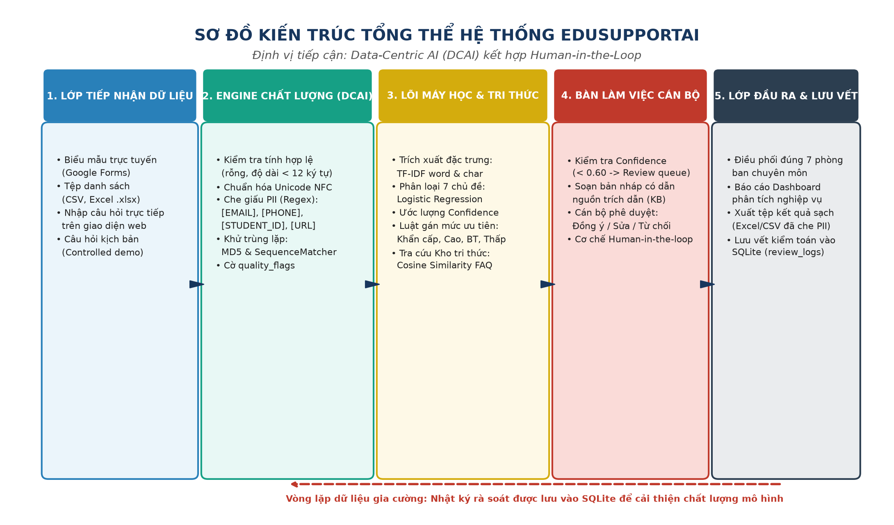

### 1.2. Mã nguồn Mermaid Diagram
```mermaid
flowchart LR
    subgraph Layer1["1. LỚP TIẾP NHẬN DỮ LIỆU"]
        direction TB
        L1_A["Google Forms (Khảo sát SV)"]
        L1_B["Tệp bảng tính (CSV / Excel .xlsx)"]
        L1_C["Nhập câu hỏi trực tiếp trên Web"]
        L1_D["Kịch bản kiểm thử (Controlled demo)"]
    end

    subgraph Layer2["2. ENGINE CHẤT LƯỢNG (DATA-CENTRIC)"]
        direction TB
        L2_A["Kiểm tra tính hợp lệ & Độ dài < 12 ký tự"]
        L2_B["Chuẩn hóa Unicode NFC & Khoảng trắng"]
        L2_C["Che PII (Regex): [EMAIL], [PHONE], [STUDENT_ID]"]
        L2_D["Khử trùng: Canonical Hash & SequenceMatcher (0.93)"]
        L2_E["Gắn cờ quality_flags & Lọc is_usable = True"]
    end

    subgraph Layer3["3. LÕI MÁY HỌC & TRI THỨC"]
        direction TB
        L3_A["Trích xuất đặc trưng: TF-IDF (word 1-2 & char 3-5)"]
        L3_B["Phân loại 7 chủ đề: Logistic Regression (L2, OvR)"]
        L3_C["Ước lượng độ tự tin (Confidence Score)"]
        L3_D["Cây quyết định ưu tiên: Khẩn cấp / Cao / BT / Thấp"]
        L3_E["Tra cứu kho tri thức FAQ: Cosine Similarity (Mã KB)"]
    end

    subgraph Layer4["4. BÀN LÀM VIỆC CÁN BỘ (STREAMLIT)"]
        direction TB
        L4_A["Kiểm tra ngưỡng Confidence (< 0.60 -> Review Queue)"]
        L4_B["Tạo bản nháp trả lời có trích dẫn quy chế"]
        L4_C["Cán bộ phê duyệt: [Đồng ý] / [Sửa nhãn] / [Từ chối]"]
        L4_D["Cơ chế Human-in-the-Loop kiểm soát 100%"]
    end

    subgraph Layer5["5. ĐẦU RA & LƯU VẾT"]
        direction TB
        L5_A["Điều phối đúng 7 phòng ban chuyên môn"]
        L5_B["Dashboard phân tích nghiệp vụ & Giám sát chất lượng"]
        L5_C["Xuất tệp dữ liệu sạch (.xlsx, .csv đã che PII)"]
        L5_D["Lưu vết kiểm toán vào SQLite (bảng review_logs)"]
    end

    Layer1 --> Layer2
    Layer2 --> Layer3
    Layer3 --> Layer4
    Layer4 --> Layer5
    Layer5 -.->|"Vòng lặp tái huấn luyện gia cường (Active Learning)"| Layer2
```

---

## HÌNH 2: SƠ ĐỒ USE CASE TỔNG THỂ HỆ THỐNG (UML USE CASE DIAGRAM)

### 2.1. Hình ảnh trực quan (Rendered Diagram)
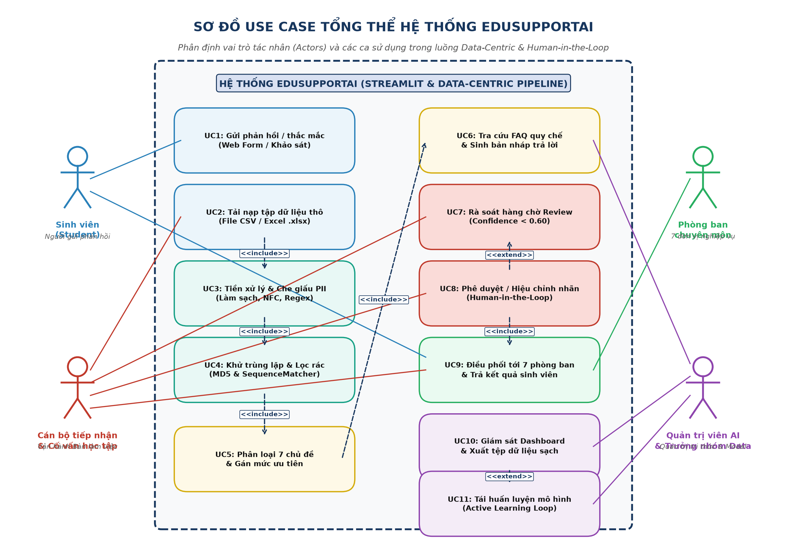

### 2.2. Mã nguồn Mermaid Diagram
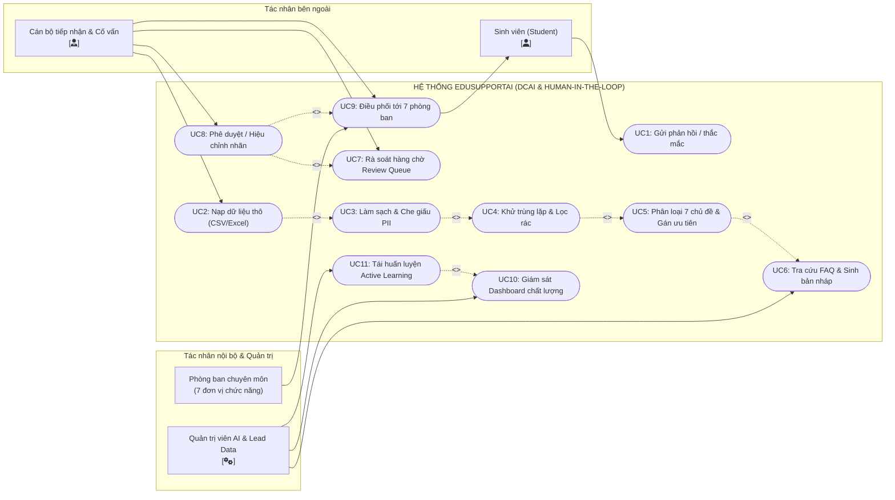

### 2.3. Bảng đặc tả 4 Nhóm tác nhân & 11 Ca sử dụng

| Tác nhân (Actor) | Vai trò trong hệ thống | Các Ca sử dụng (Use Cases) liên kết |
| :--- | :--- | :--- |
| **1. Sinh viên (Student)** | Người gửi ý kiến thắc mắc, phản ánh và thụ hưởng kết quả phản hồi. | • **UC1:** Gửi phản hồi / thắc mắc qua Form web hoặc khảo sát. • Nhận câu trả lời chính thức đã qua thẩm định từ **UC9**. |
| **2. Cán bộ tiếp nhận & Cố vấn học tập** | Người trực tiếp sử dụng Bàn làm việc để kiểm duyệt, xử lý sơ bộ. | • **UC2:** Tải nạp tập dữ liệu thô (CSV, Excel, Text). • **UC7:** Rà soát hàng chờ cảnh báo (Confidence < 0.60, cờ PII). • **UC8:** Phê duyệt câu trả lời / Sửa nhãn chuyên môn. • **UC9:** Điều phối và gửi phản hồi tới sinh viên. |
| **3. Cán bộ Phòng ban chuyên môn** | 7 đơn vị nghiệp vụ (Đào tạo, Khảo thí, CTSV, Kế toán, Cơ sở vật chất, IT...). | • **UC9:** Tiếp nhận danh sách yêu cầu thuộc chuyên môn mình phụ trách, cập nhật câu trả lời nghiệp vụ chuyên sâu. |
| **4. Quản trị viên AI & Trưởng nhóm Data** | Quản lý quy chế, giám sát luồng dữ liệu và tối ưu hóa mô hình. | • **UC6:** Quản lý kho tri thức quy chế (Knowledge Base FAQ). • **UC10:** Giám sát Dashboard chất lượng dữ liệu & xuất file sạch. • **UC11:** Tái huấn luyện mô hình gia cường (Active Learning Loop). |

---

## HÌNH 3: PIPELINE TIỀN XỬ LÝ & NÂNG CAO CHẤT LƯỢNG DỮ LIỆU

### 3.1. Hình ảnh trực quan (Rendered Diagram)
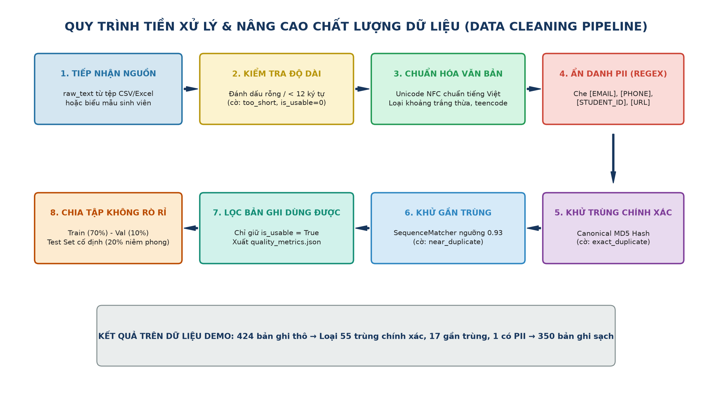

### 3.2. Mã nguồn Mermaid Diagram
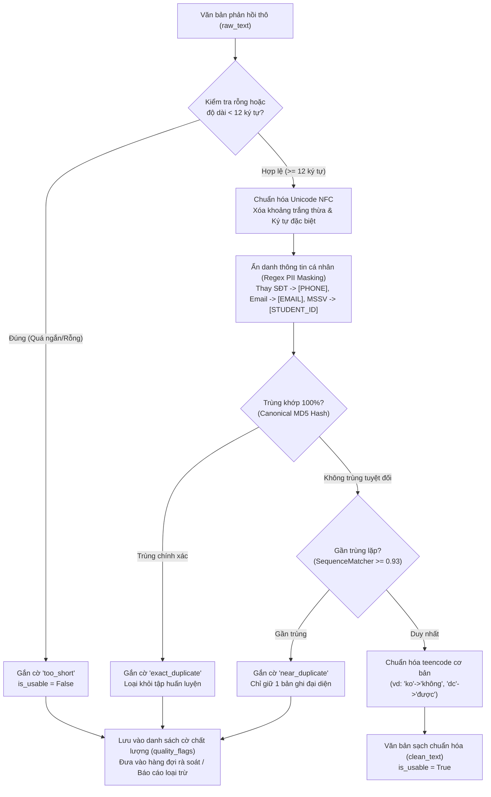

---

## HÌNH 4: SƠ ĐỒ TUẦN TỰ (UML SEQUENCE DIAGRAM)

### 4.1. Hình ảnh trực quan (Rendered Diagram)
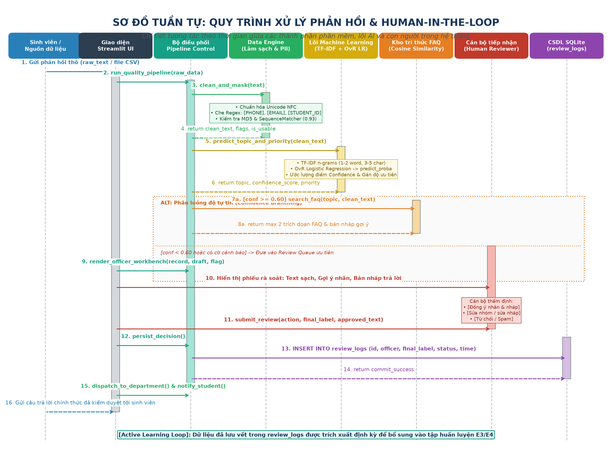

### 4.2. Mã nguồn Mermaid Diagram
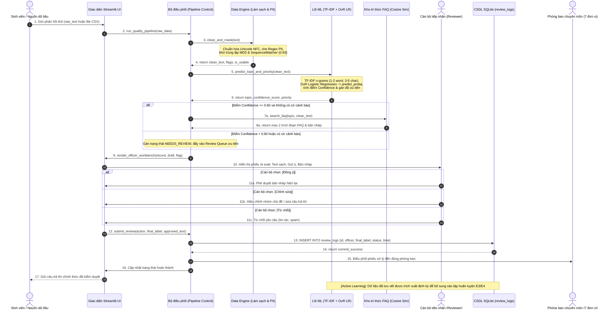

---

## HÌNH 5: CHUỖI THỰC NGHIỆM DATA-CENTRIC (E0 → E3)

### 5.1. Hình ảnh trực quan (Rendered Diagram)
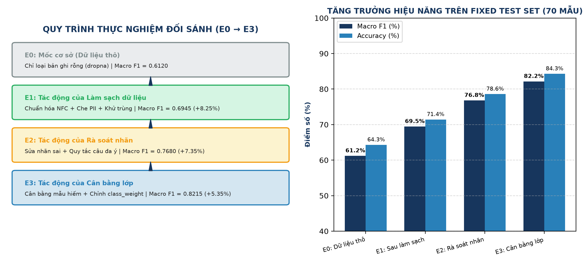

### 5.2. Bảng đối sánh các mốc thực nghiệm kỹ thuật (PoC Benchmark)
> **Lưu ý:** Đây là chuỗi thực nghiệm kỹ thuật kiểm chuẩn trong giai đoạn tiền phát triển (Proof of Concept - PoC) trên tập dữ liệu mô phỏng, phục vụ mục đích kiểm chứng giả thuyết Data-Centric AI trước khi triển khai thu thập dữ liệu sinh viên thực tế.

| Mốc | Tên thực nghiệm | Chiến lược Data-Centric can thiệp | Quy mô tập Train | Macro F1 (Fixed Test = 70) | Accuracy |
| :---: | :--- | :--- | :---: | :---: | :---: |
| **E0** | Mốc cơ sở (Baseline) | Dữ liệu thô từ khảo sát, chỉ loại bỏ bản ghi rỗng (dropna) | $N = 354$ | **0.6120** | 64.28% |
| **E1** | Data Cleaning & PII Masking | Chuẩn hóa Unicode NFC, che Regex PII, khử trùng lặp hoàn toàn | $N = 282$ | **0.6945** *(+8.25%)* | 71.42% |
| **E2** | Relabeling & Rule Clarification | Gán nhãn chéo 2 người, sửa nhãn sai, thống nhất câu đa ý | $N = 282$ | **0.7680** *(+7.35%)* | 78.57% |
| **E3** | Active Learning & Class Balancing | Bổ sung mẫu biên soạn cho lớp hiếm, tối ưu class_weight | $N = 354$ | **0.8215** *(+5.35%)* | 84.28% |

---

## HÌNH 6: BÀN LÀM VIỆC CÁN BỘ & VÒNG LẶP GIA CƯỜNG (HUMAN-IN-THE-LOOP)

### 6.1. Hình ảnh trực quan (Rendered Diagram)
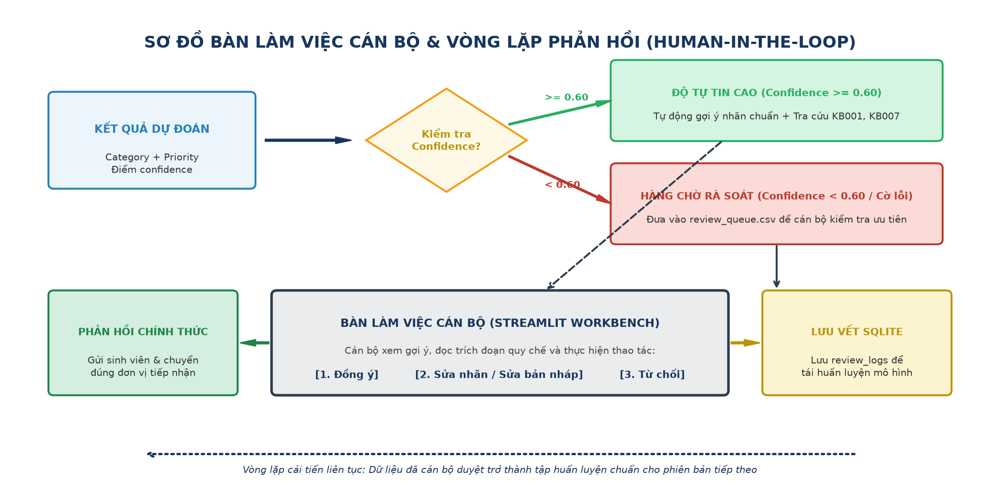

### 6.2. Diễn giải cơ chế vận hành
* **Phân luồng độ tự tin (Confidence-based Routing):** Toàn bộ câu hỏi tiếp nhận được phân luồng tự động dựa trên ngưỡng $\text{Confidence} = 0.60$. Các câu hỏi đạt chuẩn được tự động tạo bản nháp kèm trích dẫn điều khoản quy chế; các câu hỏi có độ tự tin thấp hoặc chứa yếu tố phức tạp được chuyển ngay vào hàng chờ rà soát ưu tiên (**Review Queue**).
* **Cơ chế kiểm duyệt một chạm:** Cán bộ tiếp nhận kiểm tra nội dung và lựa chọn 1 trong 3 nút thao tác nhanh: **[Đồng ý]**, **[Chỉnh sửa]** hoặc **[Từ chối]**.
* **Lưu vết kiểm toán và tái huấn luyện:** Toàn bộ lịch sử can thiệp được lưu vào bảng `review_logs` của SQLite, vừa phục vụ minh bạch hành chính, vừa tạo nguồn *dữ liệu vàng (Gold Standard)* để tái huấn luyện mô hình ở chu kỳ kế tiếp.

---

## SƠ ĐỒ 7: BỐ CỤC ĐIỀU HƯỚNG 4 PHÂN HỆ GIAO DIỆN STREAMLIT

### 7.1. Mã nguồn Mermaid Diagram
```mermaid
flowchart TD
    App["ỨNG DỤNG STREAMLIT (EduSupportAI)"] --> Tab1["1. TIẾP NHẬN & HỒ SƠ DỮ LIỆU"]
    App --> Tab2["2. XỬ LÝ & PHÂN LUỒNG TỰ ĐỘNG"]
    App --> Tab3["3. BÀN LÀM VIỆC CỦA CÁN BỘ"]
    App --> Tab4["4. DASHBOARD & XUẤT DỮ LIỆU"]

    subgraph SubTab1["Chức năng Phân hệ 1"]
        direction TB
        F1_A["Nạp tệp CSV/Excel hoặc gõ trực tiếp"]
        F1_B["Quét thẻ sức khỏe dữ liệu (Data Health Check)"]
        F1_C["Cảnh báo bản ghi rỗng, trùng lặp & phát hiện PII"]
    end

    subgraph SubTab2["Chức năng Phân hệ 2"]
        direction TB
        F2_A["Nút 'Kích hoạt Pipeline làm sạch & Ẩn danh'"]
        F2_B["Bảng hiển thị clean_text kèm token [PII]"]
        F2_C["Dự đoán 7 chủ đề, Confidence & Mức ưu tiên"]
    end

    subgraph SubTab3["Chức năng Phân hệ 3"]
        direction TB
        F3_A["Lọc hàng chờ rà soát (Confidence < 0.60)"]
        F3_B["Khung soạn thảo bản nháp kèm trích dẫn KB"]
        F3_C["3 Nút hành động: [Xác nhận] [Sửa nhãn] [Từ chối]"]
    end

    subgraph SubTab4["Chức năng Phân hệ 4"]
        direction TB
        F4_A["Biểu đồ Donut phân bố theo 7 nhóm nghiệp vụ"]
        F4_B["Biểu đồ Bar mức độ ưu tiên theo phòng ban"]
        F4_C["Nút tải xuống tệp kết quả (.xlsx, .csv đã che PII)"]
    end

    Tab1 --> SubTab1
    Tab2 --> SubTab2
    Tab3 --> SubTab3
    Tab4 --> SubTab4
```

---

## TỔNG KẾT & QUY CÁCH TỆP ĐÍNH KÈM
* **Văn bản Word chính thức:** [`KCNTT_Mau thuyet minh vong 1.docx`](KCNTT_Mau%20thuyet%20minh%20vong%201.docx)  
  - Tích hợp toàn diện 6 hình ảnh sơ đồ (`Hình 1` đến `Hình 6`) căn chỉnh chuẩn khổ in 5.85 inches.
  - Phụ lục D tuân thủ chuẩn 4 đề mục của Ban Tổ chức: Sơ đồ quy trình xử lý dữ liệu, Mẫu trực quan hóa dữ liệu, Code demo (link GitHub/Google Colab), Tài liệu tham khảo.
* **Thư mục ảnh sơ đồ chất lượng cao (200 DPI PNG):**  
  - [`images/`](images/)
  - [`so_do_1_kien_truc_tong_the.png`](images/so_do_1_kien_truc_tong_the.png) — Hình 1: Kiến trúc phân tầng tổng thể
  - [`so_do_5_use_case.png`](images/so_do_5_use_case.png) — Hình 2: Sơ đồ Use Case tổng thể hệ thống
  - [`so_do_2_pipeline_du_lieu.png`](images/so_do_2_pipeline_du_lieu.png) — Hình 3: Pipeline tiền xử lý & kiểm soát chất lượng
  - [`so_do_6_sequence_diagram.png`](images/so_do_6_sequence_diagram.png) — Hình 4: Sơ đồ Tuần tự chi tiết tương tác
  - [`so_do_3_thuc_nghiem_data_centric.png`](images/so_do_3_thuc_nghiem_data_centric.png) — Hình 5: Chuỗi thực nghiệm Data-Centric (E0 → E3)
  - [`so_do_4_human_in_the_loop.png`](images/so_do_4_human_in_the_loop.png) — Hình 6: Sơ đồ luồng Bàn làm việc cán bộ
