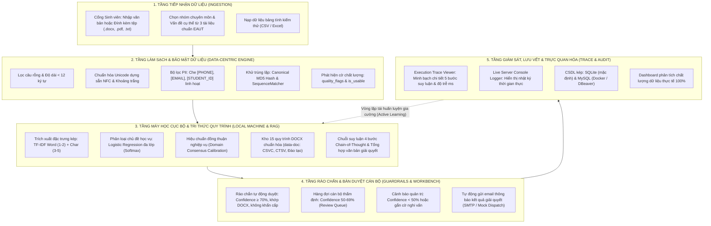

# EDUSUPPORTAI — HỆ THỐNG NÂNG CAO CHẤT LƯỢNG DỮ LIỆU & TỰ ĐỘNG PHÂN LOẠI PHẢN HỒI SINH VIÊN
## Đề tài Cuộc thi: Centric Data AI 2026 (Khoa CNTT — Trường Đại học Công nghệ Đông Á - EAUT)
**Định vị phương pháp tiếp cận:** Data-Centric AI (DCAI) kết hợp Bàn làm việc kiểm duyệt con người (Human-in-the-Loop) & Máy học Cục bộ (Local Learning Machine)

---

## 1. GIỚI THIỆU & ĐỊNH HƯỚNG PHÁT TRIỂN

**EduSupportAI** là giải pháp phần mềm chuyên sâu giải quyết bài toán tiếp nhận, chuẩn hóa, làm sạch dữ liệu, tự động phân luồng và lập luận giải quyết phản ánh của sinh viên trong môi trường đại học. Thay vì phụ thuộc vào các API mô hình ngôn ngữ lớn (LLM) bên ngoài đắt đỏ, tiềm ẩn rủi ro lộ lọt thông tin cá nhân (PII) và ảo giác thông tin (*hallucination*), hệ thống ứng dụng triệt để triết lý **Data-Centric AI (DCAI)** kết hợp **Local Learning Machine**:
* **Chuẩn hóa & Bảo mật PII:** Tự động lọc sạch ký tự rác, chuẩn hóa Unicode NFC, khử trùng lặp và che giấu thông tin cá nhân nhạy cảm (`[PHONE]`, `[EMAIL]`, `[STUDENT_ID]`).
* **Máy học cục bộ & Tra cứu quy chế chính thức (RAG Cục bộ):** Trích xuất tự động và chuẩn hóa 15 quy trình nghiệp vụ chính thức từ 3 tài liệu Word (*data-doc*) của Nhà trường.
* **Chuỗi suy luận Chain-of-Thought minh bạch:** Lập luận 4 bước logic theo đúng thể thức hành chính, trích dẫn chuẩn xác căn cứ văn bản, thời hạn giải quyết (SLA) và biểu mẫu.
* **Cơ chế Phân luồng & Hiệu chuẩn Độ tin cậy:** Tự động phê duyệt ($\ge 70\%$), chuyển bàn duyệt cán bộ ($50\% - 69\%$), và bật cờ cảnh báo quản trị ($< 50\%$).
* **Minh bạch hóa 100% (Explainable AI & Live Logging):** Ghi nhận chi tiết từng bước thực thi (mili-giây) ra Execution Trace và Live Server Console thời gian thực.

---

## 2. KIẾN TRÚC TỔNG THỂ HỆ THỐNG (5 TẦNG KỸ THUẬT)



---

## 3. CẤU TRÚC THƯ MỤC DỰ ÁN

```text
centric_data_ai_nhom67/
├── app/
│   ├── main.py                     # Ứng dụng Streamlit chính (Cổng sinh viên, tích hợp 4 phân hệ)
│   └── components/
│       ├── __init__.py
│       ├── workbench.py            # Bàn làm việc cán bộ duyệt & Quản lý phân luồng chuyên môn
│       ├── dashboard.py            # Thống kê chất lượng dữ liệu & Lịch sử kiểm toán
│       ├── knowledge_center.py     # Trung tâm tri thức DOCX & Huấn luyện máy học cục bộ
│       └── trace_viewer.py         # Trực quan hóa nhật ký thực thi & Suy luận nội tâm của Model
├── src/
│   ├── __init__.py
│   ├── app_logger.py               # Runtime Logger thời gian thực (Terminal stdout & Live Console)
│   ├── cleaner.py                  # Pipeline làm sạch Unicode NFC, Regex PII, Khử trùng lặp
│   ├── config.py                   # Cấu hình hệ thống, ngưỡng phân luồng, đường dẫn CSDL
│   ├── database.py                 # Quản trị CSDL SQLite (bảng requests, traces, logs, emails, kb)
│   ├── data_generator.py           # Sinh dữ liệu kịch bản kiểm thử nội bộ
│   ├── doc_parser.py               # Trích xuất & chuẩn hóa 15 quy trình nghiệp vụ từ file Word (.docx)
│   ├── email_service.py            # Dịch vụ gửi email thông báo giải quyết (SMTP thực tế & Mock)
│   ├── faq_engine.py               # Engine tra cứu quy chế học vụ bằng Cosine Similarity
│   ├── local_machine.py            # Lõi Máy học Cục bộ (Local Learning Machine) & Chuỗi suy luận CoT
│   ├── model.py                    # Pipeline TF-IDF kép + Logistic Regression đa lớp
│   ├── quality_profiler.py         # Quét hồ sơ chất lượng dữ liệu: rỗng, quá ngắn, trùng lặp, cờ PII
│   ├── service.py                  # Service điều phối luồng xử lý 5 bước & Rào chắn Guardrails
│   └── trace_logger.py             # Bộ ghi vết thực thi (Execution Trace) đo đạc mili-giây
├── doc/                            # Toàn bộ tài liệu đọc & quy trình chuẩn hóa EAUT
│   ├── baocao-quanly-csvc-eaut.docx              # Tài liệu Quy trình CSVC & Giảng đường
│   ├── bao_cao_quy_trinh_nghiep_vu_sinh_vien_eaut.docx # Tài liệu Quy trình CTSV & Chế độ chính sách
│   ├── bao_cao_tong_hop_quy_trinh_dao_tao.docx   # Tài liệu Quy trình Đào tạo & Khảo thí
│   ├── TOM_TAT_DO_TIN_CAY_AI.md                  # Cơ chế tính toán & xử lý độ tin cậy
│   ├── HUONG_DAN_KET_NOI_MYSQL_DBEAVER.md        # Hướng dẫn kết nối MySQL qua DBeaver
│   ├── SO_DO_HE_THONG_EDUSUPPORT_AI.md           # Hệ thống sơ đồ kỹ thuật & Mermaid
│   ├── DEMO_5_PHUT.md                            # Kịch bản diễn tập thuyết trình 5 phút
│   ├── KE_HOACH_PHAT_TRIEN.md                    # Lộ trình phát triển hệ thống
│   ├── KIEM_THU.md                               # Kế hoạch và kịch bản kiểm thử
│   └── TODO.md                                   # Bảng phân vai & theo dõi tiến độ
├── data/
│   ├── edusupport.db               # Cơ sở dữ liệu SQLite hoạt động thực tế
│   ├── kb/
│   │   ├── eaut_faq_kb.csv         # Kho tri thức quy chế FAQ 15 điều khoản chuẩn hóa
│   │   └── eaut_procedures_kb.json # Danh mục 15 quy trình nghiệp vụ trích xuất từ data-doc
│   ├── mau_phan_anh_thuc_te_eaut.csv # 50 mẫu khảo sát thực tế đa dạng chủ đề và mức ưu tiên
│   ├── processed/
│   │   └── dataset_clean.csv       # Tập dữ liệu sạch sau chuẩn hóa
│   ├── raw/
│   │   └── synthetic_demo_424.csv  # Tập dữ liệu thô ban đầu
│   └── splits/
│       ├── train.csv               # Tập huấn luyện
│       ├── val.csv                 # Tập kiểm định
│       └── test_sealed.csv         # Tập kiểm thử niêm phong
├── models/
│   └── best_classifier.joblib      # Trọng số mô hình phân loại tốt nhất
├── scripts/
│   ├── init_mysql.sql              # Kịch bản DDL khởi tạo schema trên MySQL
│   └── migrate_to_mysql.py         # Script đồng bộ toàn bộ dữ liệu SQLite sang MySQL
├── experiments/
│   ├── benchmark_results.json      # Kết quả thực nghiệm kiểm chuẩn DCAI
│   ├── error_analysis.py           # Phân tích ca phân loại sai (Confusion Matrix)
│   └── run_experiments.py          # Script chạy chuỗi thực nghiệm E0 -> E3
├── tests/
│   ├── test_mvp.py                 # Kiểm thử hồi quy chức năng nền tảng
│   ├── test_app.py                 # Kiểm thử giao diện Streamlit và các phân hệ
│   ├── test_email_service.py       # Kiểm thử dịch vụ email và ghi vết CSDL
│   └── test_local_machine.py       # Kiểm thử Máy học cục bộ, Doc Parser và Trace Logger
├── images/                         # 6 sơ đồ kiến trúc kỹ thuật hệ thống
├── demo_live.py                    # Script kiểm thử và diễn tập 6 tình huống thực tế
├── run_mvp.py                      # Script khởi chạy ứng dụng nhanh
├── CHAY_DEMO_WINDOWS.bat           # File batch khởi chạy 1-click trên môi trường Windows
├── requirements.txt                # Danh sách thư viện Python phụ thuộc
└── readme.md                       # Tài liệu hướng dẫn phát triển hệ thống
```

---

## 4. CÁC PHÂN HỆ CHỨC NĂNG TRÊN GIAO DIỆN STREAMLIT

Hệ thống được thiết kế theo phong cách **Sapphire Academic & Slate**, tối giản, không sử dụng emoji rườm rà, tập trung 100% vào nghiệp vụ:

### Tab 0: Cổng Tiếp nhận & Phân loại Phản ánh Sinh viên
* Tiếp nhận ý kiến sinh viên thông qua nhập văn bản trực tiếp hoặc tải tệp đơn từ (`.docx`, `.pdf`, `.txt`).
* Lựa chọn nhanh tình huống mẫu hoặc phân loại theo 3 nhóm chuyên môn chính thức từ 3 tài liệu quy trình:
  1. *Cơ sở vật chất & Giảng đường* (Phòng Quản trị CSVC).
  2. *Công tác sinh viên & Chế độ chính sách* (Phòng Công tác sinh viên).
  3. *Quản lý Đào tạo & Khảo thí* (Phòng Quản lý Đào tạo & Khảo thí).
* Tự động làm sạch dữ liệu, che giấu PII bảo mật, phân tích độ tin cậy và tạo bản nháp giải quyết ngay lập tức.

### Tab 1: Bàn duyệt Cán bộ & Quản lý Phân luồng (Workbench)
* Bảng danh sách yêu cầu thông minh:
  * Sắp xếp theo ngày đăng (Mới nhất / Cũ nhất) hoặc mức độ ưu tiên.
  * Bộ lọc đa chiều: Theo Đơn vị chuyên môn, Trạng thái (`Chờ duyệt`, `Tự động duyệt`), Ngưỡng tin cậy AI, Mức ưu tiên.
  * **Tương tác 1 chạm:** Bấm chọn trực tiếp một dòng bất kỳ trên bảng để mở ngay hồ sơ duyệt chi tiết bên dưới.
* Đối chiếu căn cứ pháp lý, quy trình DOCX chính thức và các bước giải quyết.
* Thao tác duyệt: `[Lưu nháp]`, `[Duyệt và lưu]`, `[Từ chối]`. Tự động gửi email thông báo kết quả về hòm thư người gửi.

### Tab 2: Trung tâm Tri thức & Huấn luyện Máy học Cục bộ (Knowledge Center)
* Quản lý 15 quy trình nghiệp vụ trích xuất từ 3 tài liệu Word (*data-doc*).
* Cho phép thử nghiệm tra cứu quy trình tương đồng theo thời gian thực bằng Cosine Similarity.
* Tính năng **Huấn luyện lại Máy học Cục bộ (Retrain Local Machine)**: Tự động tổng hợp dữ liệu huấn luyện mở rộng từ kho quy trình và cập nhật trọng số mô hình ngay trên giao diện.

### Tab 3: Thống kê Dữ liệu & Lịch sử Kiểm toán (Dashboard & Trace)
* Bảng thống kê toàn diện các yêu cầu trong hệ thống kèm tính năng chọn dòng xem vết thực thi.
* Quét hồ sơ chất lượng dữ liệu động từ tệp CSV/Excel tải lên: Đo lường tỷ lệ câu rỗng, câu ngắn, trùng lặp tuyệt đối, tỷ lệ PII, và điểm sức khỏe dữ liệu (*Data Health Score*).
* **Live Server Console Widget:** Hiển thị toàn bộ nhật ký ứng dụng thời gian thực với các cấp độ `INFO`, `SUCCESS`, `WARNING`, `ERROR`.

---

## 5. CƠ CHẾ TÍNH TOÁN & HIỆU CHUẨN ĐỘ TIN CẬY (CONFIDENCE SCORE)

Chi tiết đặc tả tại tài liệu [TOM_TAT_DO_TIN_CAY_AI.md](doc/TOM_TAT_DO_TIN_CAY_AI.md):

1. **Trích xuất đặc trưng đa tầng (`src/model.py`):**
   * Word n-gram TF-IDF (1, 2): Bắt từ khóa chuyên môn học vụ.
   * Char n-gram TF-IDF (3, 5): Bắt biến thể viết tắt, lỗi chính tả, teencode sinh viên.
2. **Xác suất Softmax nguyên bản (`src/model.py`):**
   * Dự đoán xác suất $P(C_i \mid X) = \frac{e^{\mathbf{w}_i^T \mathbf{x} + b_i}}{\sum_{k} e^{\mathbf{w}_k^T \mathbf{x} + b_k}}$ trên 7 nhóm chuyên môn.
   * Biên độ quyết định $\text{Margin} = P_{\text{top1}} - P_{\text{top2}}$.
3. **Hiệu chuẩn đồng thuận nghiệp vụ (`src/service.py`):**
   * **Đồng thuận (AI khớp lựa chọn người dùng):** Thưởng độ tin cậy: $Conf = \min\big(0.95, \, \max(0.88, \, Conf_{\text{raw}} + 0.40)\big)$.
   * **Điều chỉnh (AI lệch nhưng người dùng có chỉ định):** Hiệu chuẩn an toàn: $Conf = \min\big(0.92, \, \max(0.88, \, P_{\text{topic}} + 0.40)\big)$.
   * **Tự do:** Giữ nguyên xác suất Softmax thô.
4. **Ngưỡng rào chắn phân luồng:**
   * $\ge 70\%$: **Tự động phê duyệt (AI)** và gửi email giải quyết (nếu khớp DOCX và không khẩn cấp).
   * $50\% - 69\%$: **Chờ cán bộ duyệt** tại bàn làm việc chuyên môn.
   * $< 50\%$: **Cảnh báo quản trị** và gắn cờ yêu cầu rà soát kỹ lưỡng.
   * $< 12$ ký tự: Gán độ tin cậy $0.0\%$, nhắc bổ sung thông tin.

---

## 6. HƯỚNG DẪN CÀI ĐẶT & KHỞI CHẠY

### Bước 1: Khởi tạo môi trường ảo & Cài đặt thư viện
```bash
# Tạo môi trường ảo Python 3.10+
python3 -m venv venv
source venv/bin/activate

# Cài đặt toàn bộ thư viện
pip install -r requirements.txt
```

### Bước 2: Chạy kiểm thử tự động toàn diện (26 Unit Tests)
```bash
python3 -m unittest discover tests
```
*Kết quả chuẩn: `Ran 26 tests in ~9.0s — OK`.*

### Bước 3: Chạy kịch bản Demo thực tế 6 tình huống (CLI Live Demo)
```bash
python3 demo_live.py
```
*Kịch bản diễn tập: Làm sạch PII -> Lọc rác/câu ngắn -> Khử trùng lặp -> Phê duyệt SQLite -> Quét chất lượng dữ liệu -> Minh bạch Execution Trace Log.*

### Bước 4: Khởi chạy Ứng dụng Web Streamlit
```bash
# Cách 1: Khởi chạy bằng script tiện ích
python3 run_mvp.py

# Cách 2: Khởi chạy trực tiếp qua Streamlit CLI
streamlit run app/main.py
```
*Truy cập ứng dụng tại: `http://localhost:8501`.*

*(Dành cho người dùng Windows: Có thể click đúp chuột vào file `CHAY_DEMO_WINDOWS.bat` để tự động khởi chạy).*

---

## 7. QUẢN TRỊ CƠ SỞ DỮ LIỆU (SQLITE & MYSQL)

Hệ thống hỗ trợ cơ chế lưu trữ dữ liệu kép linh hoạt:
1. **SQLite (Mặc định):** Tệp CSDL cục bộ lưu tại `data/edusupport.db`. Không yêu cầu cài đặt máy chủ phụ trợ.
2. **MySQL (Môi trường Doanh nghiệp / Docker):**
   * Khởi chạy Docker MySQL container theo hướng dẫn trong [HUONG_DAN_KET_NOI_MYSQL_DBEAVER.md](doc/HUONG_DAN_KET_NOI_MYSQL_DBEAVER.md).
   * Chạy kịch bản di chuyển toàn bộ dữ liệu từ SQLite sang MySQL:
     ```bash
     python3 scripts/migrate_to_mysql.py
     ```
   * Hỗ trợ kết nối và truy vấn trực quan qua DBeaver / MySQL Workbench.

---

## 8. DANH MỤC TÀI LIỆU QUAN TRỌNG TRONG DỰ ÁN
* [doc/TOM_TAT_DO_TIN_CAY_AI.md](doc/TOM_TAT_DO_TIN_CAY_AI.md): Cơ chế tính toán và hiệu chuẩn độ tin cậy AI.
* [doc/SO_DO_HE_THONG_EDUSUPPORT_AI.md](doc/SO_DO_HE_THONG_EDUSUPPORT_AI.md): Hệ thống sơ đồ kỹ thuật, luồng dữ liệu & Mermaid.
* [doc/HUONG_DAN_KET_NOI_MYSQL_DBEAVER.md](doc/HUONG_DAN_KET_NOI_MYSQL_DBEAVER.md): Hướng dẫn kết nối và quản trị MySQL với DBeaver.
* [doc/DEMO_5_PHUT.md](doc/DEMO_5_PHUT.md): Kịch bản thuyết trình và diễn tập bảo vệ đề tài 5 phút.
* [doc/KE_HOACH_PHAT_TRIEN.md](doc/KE_HOACH_PHAT_TRIEN.md): Kế hoạch và lộ trình phát triển mở rộng.
* [doc/KIEM_THU.md](doc/KIEM_THU.md): Kế hoạch và kịch bản kiểm thử đảm bảo chất lượng.
* [doc/TODO.md](doc/TODO.md): Bảng theo dõi tiến độ công việc và checklist nhiệm vụ.
