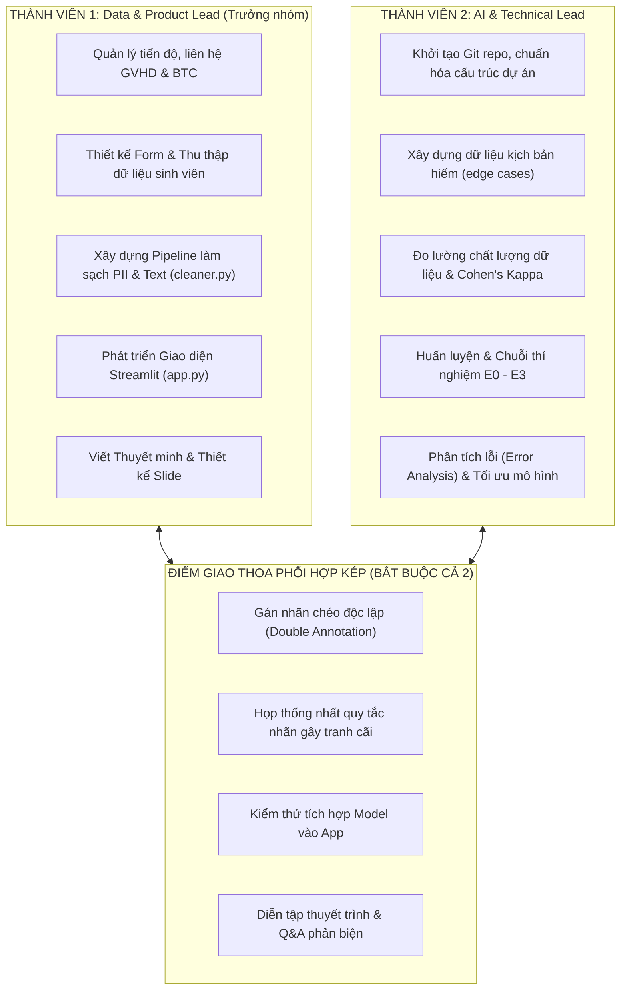

# PHÂN CÔNG CÔNG VIỆC CHO NHÓM 2 NGƯỜI
## Dự án: EduFeedback AI (Cuộc thi Centric Data AI 2026)
*Áp dụng cho cấu trúc nhóm 2 thành viên: Tối ưu năng suất, không chồng chéo, tận dụng tối đa thế mạnh của từng người.*

---

## 1. MÔ HÌNH PHÂN CHIA VAI TRÒ (2 THÀNH VIÊN)

Trong mô hình nhóm 2 người, cấu trúc phân vai lý tưởng nhất là: **Một người phụ trách Dữ liệu & Sản phẩm (Data & Product Lead)**, **Một người phụ trách Mô hình & Kỹ thuật lõi (ML & Technical Lead)**.



---

## 2. BẢNG TRÁCH NHIỆM CHI TIẾT THEO VAI TRÒ

| Tiêu chí | Thành viên 1: Trưởng nhóm (Data & Product) | Thành viên 2: Kỹ thuật (ML & Architecture) |
| :--- | :--- | :--- |
| **Trọng tâm chính** | **Dữ liệu thô $\rightarrow$ Dữ liệu sạch $\rightarrow$ Giao diện người dùng $\rightarrow$ Báo cáo** | **Kiến trúc $\rightarrow$ Kiểm chuẩn $\rightarrow$ Thí nghiệm E0-E3 $\rightarrow$ Mô hình** |
| **Công việc Dữ liệu** | • Tạo Google Forms, chia sẻ link thu thập.<br>• Viết quy tắc làm sạch: khử SĐT, Email, MSSV.<br>• Chuẩn hóa Unicode, teencode.<br>• Gán nhãn lần 1 (Annotator A). | • Thiết kế schema 7 trường dữ liệu.<br>• Viết kịch bản mẫu hiếm/thiểu số.<br>• Code script đo Cohen's Kappa.<br>• Gán nhãn độc lập lần 2 (Annotator B). |
| **Công việc AI / Code** | • Xây dựng giao diện `Streamlit` (F01 - F07).<br>• Hiển thị báo cáo dữ liệu, form sửa nhãn.<br>• Tạo dashboard thống kê. | • Xây dựng pipeline `scikit-learn` (TF-IDF + LinearSVC/LogisticRegression).<br>• Chạy thực nghiệm E0, E1, E2, E3.<br>• Phân tích lỗi & vẽ Confusion Matrix. |
| **Tài liệu & Thuyết trình** | • Soạn thảo bản nộp Word/PDF Vòng Sơ loại.<br>• Thiết kế Slide Chung kết.<br>• Thuyết trình phần: Bối cảnh, Dữ liệu, Demo App. | • Cung cấp biểu đồ, số liệu thực nghiệm chính xác.<br>• Soạn bộ câu hỏi phản biện kỹ thuật.<br>• Thuyết trình phần: Pipeline AI, Thí nghiệm, Q&A. |

---

## 3. LỘ TRÌNH HÀNH ĐỘNG CHI TIẾT TỪNG NGÀY CHO 2 NGƯỜI

### GIAI ĐOẠN 1: NƯỚC RÚT VÒNG SƠ LOẠI (27/09 – 01/10/2026)
*Mục tiêu tối thượng: Nộp bản Thuyết minh sơ loại có đầy đủ thông tin nhóm, GVHD và có bằng chứng dữ liệu thực nghiệm E0 ban đầu.*

| Ngày | Thành viên 1 (Data & Product) | Thành viên 2 (ML & Technical) | Kết quả chung |
| :---: | :--- | :--- | :--- |
| **27/09** *(Hôm nay)* | • Điền thông tin cá nhân 2 người vào trang bìa thuyết minh.<br>• Gửi email/tin nhắn xin xác nhận từ GVHD.<br>• Tạo Google Form thu thập ý kiến sinh viên (không hỏi PII). | • Khởi tạo kho mã nguồn GitHub riêng tư.<br>• Cài đặt môi trường `requirements.txt`.<br>• Viết 20–30 câu phản hồi giả định cho các lớp hiếm. | Có form khảo sát + Kho Git sẵn sàng. |
| **28/09** | • Lan tỏa form vào các nhóm Zalo/Facebook lớp để thu về 40–50 mẫu thật.<br>• Gán nhãn đợt 1 (Annotator A). | • Tổng hợp các mẫu thành file `pilot_100.csv` (70 mẫu thật + 30 mẫu biên soạn).<br>• Gán nhãn độc lập (Annotator B). | Có tập dữ liệu đầu tiên 100 mẫu có nhãn. |
| **29/09** | • Viết phần mô tả quy trình thực tế & bài toán trong file Thuyết minh Word. | • Viết script `baseline_e0.py` (TF-IDF + LogisticRegression).<br>• Chạy E0 trên 100 mẫu, xuất chỉ số Macro F1 và ảnh Confusion Matrix. | Có kết quả thực nghiệm E0 đầu tiên. |
| **30/09** | • Ghép số liệu 100 mẫu và biểu đồ E0 vào Thuyết minh.<br>• Rà soát văn bản, chuyển thành file PDF hoàn chỉnh. | • Kiểm tra lại tính chính xác của các thuật ngữ kỹ thuật trong tài liệu.<br>• Dựng khung giao diện Streamlit ban đầu (`app.py`). | File Thuyết minh PDF hoàn chỉnh sẵn sàng nộp. |
| **01/10** | • **Nộp hồ sơ Thuyết minh sơ loại lên cổng tiếp nhận của BTC.** | • Backup toàn bộ mã nguồn và dữ liệu lên GitHub. | Hoàn thành nộp Vòng Sơ loại. |

---

### GIAI ĐOẠN 2: MỞ RỘNG DỮ LIỆU & ENGINE CHẤT LƯỢNG (02/10 – 08/10/2026)
*Mục tiêu: Đạt mốc $\ge 300$ mẫu dữ liệu sạch, có độ tin cậy gán nhãn đạt chuẩn khoa học.*

| Ngày | Thành viên 1 (Data & Product) | Thành viên 2 (ML & Technical) | Kết quả chung |
| :---: | :--- | :--- | :--- |
| **02/10 – 04/10** | • Đẩy mạnh thu thập form để đạt $\ge 250$ phản hồi sinh viên thật.<br>• Xây dựng quy tắc gán nhãn chi tiết (Annotation Guideline) giải quyết các ca nhiều ý. | • Viết script `quality_profiler.py` (kiểm tra dòng rỗng, trùng lặp, câu quá ngắn).<br>• Bổ sung thêm các ca biên soạn để cân bằng 7 lớp. | Đạt tổng cộng $\ge 300$ phản hồi thô. |
| **05/10 – 06/10** | • Lập trình `src/cleaner.py`: Viết Regex ẩn danh SĐT (`0[3|5|7|8|9]...`), Email, MSSV; chuẩn hóa Unicode tiếng Việt NFC. | • Cùng TV1 chọn ngẫu nhiên 60 mẫu để gán nhãn độc lập 2 người.<br>• Viết script tính chỉ số **Cohen's Kappa** (mục tiêu $\ge 0.70$). | Module làm sạch PII + Chỉ số Cohen's Kappa. |
| **07/10 – 08/10** | • Chạy pipeline làm sạch toàn bộ 300 mẫu thành `dataset_v1_clean.csv`. | • Thực hiện phân chia tập cố định: Train (70%), Val (10%), Test (20%).<br>• **Khóa chặt Test Set (không chỉnh sửa)**. | Dataset v1 hoàn chỉnh và Test Set niêm phong. |

---

### GIAI ĐOẠN 3: CHUỖI THÍ NGHIỆM E1-E3 & MVP STREAMLIT (09/10 – 15/10/2026)
*Mục tiêu: Chứng minh dữ liệu sạch giúp tăng Macro F1 và hoàn thiện ứng dụng Streamlit.*

| Ngày | Thành viên 1 (Data & Product) | Thành viên 2 (ML & Technical) | Kết quả chung |
| :---: | :--- | :--- | :--- |
| **09/10 – 11/10** | • Lập trình giao diện Streamlit trang 1 & 2: Upload file (F01), Báo cáo chất lượng (F02), Nút chạy làm sạch (F03). | • Chạy **E1** (trên dữ liệu sau làm sạch của TV1).<br>• Chạy **E2** (sau khi rà soát nhãn bất đồng giữa 2 người).<br>• Đo lường sự thay đổi của Macro F1. | Hoàn thành E1, E2; UI Upload & Clean chạy tốt. |
| **12/10 – 13/10** | • Lập trình trang 3: Bảng hiển thị kết quả phân loại và cho phép người dùng sửa nhãn trực tiếp (F04, F05). | • Chạy **E3** (áp dụng cân bằng lớp `class_weight='balanced'`).<br>• Đóng gói model tốt nhất `best_model.joblib`. | Hoàn thành thí nghiệm E3; Model sẵn sàng tích hợp. |
| **14/10 – 15/10** | • Lập trình trang 4: Dashboard biểu đồ phân bố 7 nhóm phòng ban (F06) và Nút xuất file Excel/CSV (F07). | • Kết nối file `best_model.joblib` vào `app.py` để chạy dự đoán trực tiếp khi tải file.<br>• Lập bảng tổng hợp so sánh E0 $\rightarrow$ E3. | Ứng dụng MVP Streamlit hoàn chỉnh 7 chức năng. |

---

### GIAI ĐOẠN 4: KIỂM THỬ NGOẠI LỆ & BÁO CÁO CHUNG KẾT (16/10 – 21/10/2026)
*Mục tiêu: App chạy mượt mà không crash, tài liệu kỹ thuật hoàn thiện 100%.*

| Ngày | Thành viên 1 (Data & Product) | Thành viên 2 (ML & Technical) | Kết quả chung |
| :---: | :--- | :--- | :--- |
| **16/10 – 18/10** | • Tạo các file test lỗi dị thường (file chứa tiếng lóng, file thiếu cột, file rỗng hoàn toàn) để test app.<br>• Tối ưu giao diện, thông báo lỗi thân thiện. | • Xử lý các lỗi ngoại lệ (exception handling) trong code backend.<br>• Viết script phân tích lỗi: Trích xuất các câu model đoán sai để phân tích nguyên nhân. | App ổn định tuyệt đối; có báo cáo phân tích lỗi. |
| **19/10 – 21/10** | • Soạn Báo cáo kỹ thuật Vòng Chung kết (Phần Đặt vấn đề, Quy trình dữ liệu, Hướng dẫn sản phẩm). | • Soạn phần Báo cáo kỹ thuật (Phần Thí nghiệm AI, Bảng so sánh E0-E3, Ma trận nhầm lẫn, Giới hạn mô hình). | Bản Báo cáo Kỹ thuật Chung kết hoàn chỉnh. |

---

### GIAI ĐOẠN 5: ĐÓNG GÓI, SLIDE & DIỄN TẬP BẢO VỆ (22/10 – 26/10/2026)
*Mục tiêu: Thuyết trình tự tin, làm chủ mọi câu hỏi của Hội đồng Giám khảo.*

| Ngày | Thành viên 1 (Data & Product) | Thành viên 2 (ML & Technical) | Kết quả chung |
| :---: | :--- | :--- | :--- |
| **22/10 – 23/10** | • Thiết kế bộ Slide thuyết trình (Canva/PowerPoint, tối đa 12-15 slide đẹp mắt). | • Chuẩn bị file dữ liệu demo chuẩn bị sẵn.<br>• Quay video màn hình 3–5 phút demo toàn bộ quy trình từ tải file đến xuất kết quả (đề phòng sự cố). | Slide + Video demo backup. |
| **24/10 – 25/10** | • Luyện nói phần mở đầu, giới thiệu bài toán, quy trình thu thập dữ liệu và demo trực tiếp app. | • Luyện nói phần phương pháp Data-Centric, phân tích chuỗi thí nghiệm E0-E3 và trả lời câu hỏi hóc búa. | Diễn tập khớp thời gian (thường 7-10 phút). |
| **26/10** | **THI ĐẤU VÒNG CHUNG KẾT CENTRIC DATA AI 2026** | | Tự tin giành giải cao! |

---

## 4. KỊCH BẢN PHÂN VAI TRẢ LỜI PHẢN BIỆN (Q&A) TRƯỚC BAN GIÁM KHẢO

Khi Ban Giám khảo đặt câu hỏi, 2 thành viên cần phân định rõ ràng ai sẽ trả lời để tránh ngập ngừng hoặc nói tranh nhau:

```text
┌───────────────────────────────────────────────┬───────────────────────────────────────────────┐
│     THÀNH VIÊN 1 TRẢ LỜI CÁC CÂU HỎI VỀ:      │     THÀNH VIÊN 2 TRẢ LỜI CÁC CÂU HỎI VỀ:      │
├───────────────────────────────────────────────┼───────────────────────────────────────────────┤
│ • Tính thực tiễn của đề tài tại trường ĐH.   │ • Tại sao dùng TF-IDF mà không dùng LLM/BERT? │
│ • Nguồn gốc dữ liệu (Form từ đâu, bao nhiêu)? │ • Cách ngăn chặn rò rỉ dữ liệu (Data Leakage)?│
│ • Quy tắc bảo vệ riêng tư PII làm như thế nào?│ • Giải thích chỉ số Cohen's Kappa đạt bao nhiêu?│
│ • Thao tác demo ứng dụng trực tiếp trên màn   │ • Tại sao chọn Macro F1 thay vì Accuracy?     │
│   hình.                                       │ • Phân tích lý do các ca mô hình bị đoán sai. │
│ • Kế hoạch triển khai mở rộng thực tế.        │ • Cách xử lý khi các lớp bị mất cân bằng mẫu. │
└───────────────────────────────────────────────┴───────────────────────────────────────────────┘
```

---

## 5. CHECKLIST 48 GIỜ TỚI CHO 2 BẠN (CỰC KỲ KHẨN CẤP)

### Việc Thành viên 1 làm ngay:
- [ ] Mở file `EduFeedback_AI_Thuyet_minh_buoc_dau.docx`, điền tên nhóm, họ tên, MSSV, lớp của cả 2 bạn.
- [ ] Nhắn tin xin thầy/cô GVHD đồng ý đứng tên hướng dẫn đề tài.
- [ ] Lên Google Forms tạo form: gồm 1 ô nhập câu phản hồi (có giải thích mục đích nghiên cứu, ghi rõ không thu thập họ tên/SĐT).
- [ ] Gửi link vào các group lớp xin 30-40 phản hồi mẫu.

### Việc Thành viên 2 làm ngay:
- [ ] Khởi tạo thư mục và repo Git cho dự án.
- [ ] Tự gõ tay 20-30 câu phản hồi giả định (mỗi nhóm 3-4 câu để phòng hờ các nhóm hiếm).
- [ ] Chuẩn bị sẵn file Python chạy baseline TF-IDF + Logistic Regression.
- [ ] Ngay khi TV1 có 40 mẫu từ form + 30 mẫu tự gõ $\rightarrow$ gom lại thành 70-100 mẫu $\rightarrow$ bấm chạy lấy ngay chỉ số F1 và biểu đồ để TV1 dán vào thuyết minh nộp trước hạn 01/10!
