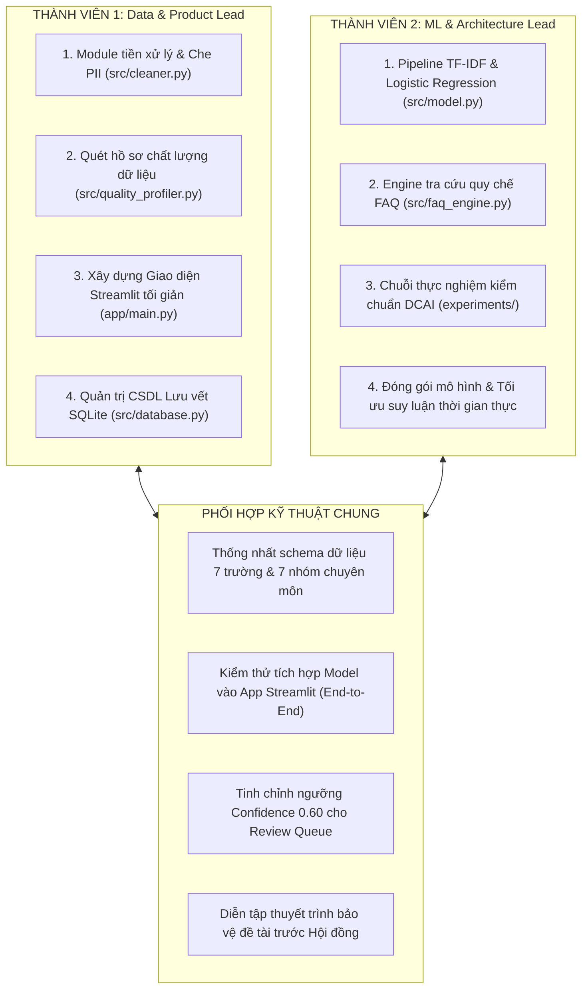

# EDUSUPPORTAI — HỆ THỐNG NÂNG CAO CHẤT LƯỢNG DỮ LIỆU & TỰ ĐỘNG PHÂN LOẠI PHẢN HỒI SINH VIÊN
## Đề tài Cuộc thi: Centric Data AI 2026 (Khoa CNTT — Trường Đại học Công nghệ Đông Á)
**Định vị phương pháp tiếp cận:** Data-Centric AI (DCAI) kết hợp Bàn làm việc kiểm duyệt con người (Human-in-the-Loop)

---

## 1. GIỚI THIỆU & ĐỊNH HƯỚNG PHÁT TRIỂN

**EduSupportAI** là giải pháp phần mềm chuyên sâu giải quyết bài toán tiếp nhận, chuẩn hóa, nâng cao chất lượng dữ liệu và tự động phân luồng phản ánh, thắc mắc của sinh viên trong môi trường đại học. Thay vì áp dụng các mô hình ngôn ngữ lớn (LLM) đắt đỏ, tiêu tốn phần cứng và tiềm ẩn rủi ro ảo giác thông tin (hallucination), hệ thống tập trung triệt để vào triết lý **Data-Centric AI**: *Tối ưu hóa chất lượng dữ liệu đầu vào để mang lại hiệu năng cao nhất trên một mô hình học máy nhẹ tải, minh bạch và an toàn.*

### QUYẾT ĐỊNH CHIẾN LƯỢC:
* **Không sử dụng số liệu khảo sát thủ công:** Dự án không sử dụng thời gian đi phát biểu mẫu Google Forms hay chờ đợi thu thập ý kiến bên ngoài.
* **Xây dựng hệ thống phân tích động trực tiếp:** Toàn bộ thống kê chất lượng dữ liệu (tỷ lệ rỗng, trùng lặp, thông tin định danh cá nhân PII) được tính toán theo thời gian thực trên dữ liệu nạp vào, không sử dụng số liệu giả định.
* **Tập trung 100% nguồn lực vào kỹ thuật AI & Phần mềm:** Triển khai ngay pipeline tiền xử lý, huấn luyện mô hình phân loại, engine tra cứu quy chế học vụ và ứng dụng Streamlit tối giản.

---

## 2. KIẾN TRÚC PHÂN TẦNG HỆ THỐNG (5 LAYERS)

Hệ thống được thiết kế theo kiến trúc phân tầng độc lập (Loose Coupling):

```mermaid
flowchart LR
    subgraph Layer1["1. TẦNG TIẾP NHẬN DỮ LIỆU"]
        direction TB
        L1_A["Tệp bảng tính thực tế (CSV / Excel)"]
        L1_B["Nhập câu hỏi trực tiếp trên Web"]
        L1_C["Dữ liệu kịch bản kiểm thử nội bộ"]
    end

    subgraph Layer2["2. ENGINE CHẤT LƯỢNG (DATA-CENTRIC)"]
        direction TB
        L2_A["Lọc câu rỗng & Độ dài < 12 ký tự"]
        L2_B["Chuẩn hóa Unicode NFC & Khoảng trắng"]
        L2_C["Che PII Regex: [PHONE], [EMAIL], [STUDENT_ID]"]
        L2_D["Khử trùng: Canonical Hash & SequenceMatcher"]
        L2_E["Gắn cờ quality_flags & Lọc is_usable"]
    end

    subgraph Layer3["3. LÕI MÁY HỌC & TRI THỨC"]
        direction TB
        L3_A["TF-IDF n-grams (word 1-2 & char 3-5)"]
        L3_B["Logistic Regression (L2, Multiclass)"]
        L3_C["Ước lượng độ tự tin (Confidence Score)"]
        L3_D["Cây quyết định ưu tiên: Khẩn cấp / Cao / Bình thường / Thấp"]
        L3_E["Tra cứu FAQ quy chế: Cosine Similarity (Mã KB)"]
    end

    subgraph Layer4["4. BÀN LÀM VIỆC CÁN BỘ (STREAMLIT)"]
        direction TB
        L4_A["Phân luồng Confidence (< 0.60 -> Review Queue)"]
        L4_B["Tự động sinh bản nháp kèm trích dẫn quy chế"]
        L4_C["Cơ chế duyệt 1 chạm: [Duyệt] [Đổi nhãn] [Từ chối]"]
        L4_D["Kiểm soát con người 100% (Human-in-the-Loop)"]
    end

    subgraph Layer5["5. ĐẦU RA & LƯU VẾT"]
        direction TB
        L5_A["Điều phối đúng 7 phòng ban chức năng"]
        L5_B["Dashboard phân tích chất lượng dữ liệu thực tế"]
        L5_C["Xuất tệp dữ liệu sạch (.csv đã che PII)"]
        L5_D["Lưu vết kiểm toán vào SQLite (review_logs)"]
    end

    Layer1 --> Layer2
    Layer2 --> Layer3
    Layer3 --> Layer4
    Layer4 --> Layer5
    Layer5 -.->|"Vòng lặp tái huấn luyện gia cường (Active Learning)"| Layer2
```



---

## 3. CẤU TRÚC THƯ MỤC DỰ ÁN

```text
centric-ai/
├── app/
│   ├── main.py                     # Giao diện chính Streamlit (3 phân hệ làm việc tối giản)
│   └── components/
│       ├── __init__.py
│       ├── workbench.py            # Giao diện Bàn làm việc cán bộ & Review Queue
│       └── dashboard.py            # Phân tích thống kê chất lượng dữ liệu thực tế
├── src/
│   ├── __init__.py
│   ├── data_generator.py           # Module sinh dữ liệu kịch bản kiểm thử nội bộ
│   ├── cleaner.py                  # Pipeline làm sạch: Unicode NFC, Regex PII, Khử trùng lặp
│   ├── quality_profiler.py         # Quét chất lượng dữ liệu: rỗng, trùng lặp, cờ PII thực tế
│   ├── model.py                    # Trích xuất TF-IDF & Logistic Regression đa lớp
│   ├── faq_engine.py               # Engine tra cứu quy chế học vụ bằng Cosine Similarity
│   └── database.py                 # Quản trị SQLite: bảng raw, processed, kb, review_logs
├── data/
│   ├── raw/                        # Dữ liệu kịch bản thô ban đầu
│   ├── processed/                  # Dữ liệu sạch sau tiền xử lý và che PII
│   ├── splits/                     # Tập Train / Val / Test_sealed
│   └── kb/
│       └── eaut_faq_kb.csv         # Kho tri thức quy chế và câu hỏi FAQ mẫu EAUT
├── models/
│   └── best_classifier.joblib      # Trọng số mô hình phân loại đã huấn luyện
├── experiments/
│   ├── __init__.py
│   ├── run_experiments.py          # Script chạy chuỗi thực nghiệm E0 -> E3
│   └── error_analysis.py           # Script phân tích các ca phân loại sai (Confusion Matrix)
├── images/                         # 6 sơ đồ kiến trúc hệ thống chuẩn 200 DPI
├── docs_tools/                     # Thư mục chứa các script hỗ trợ tài liệu (đã cho vào .gitignore)
├── KCNTT_Mau thuyet minh vong 1.docx # Bản thuyết minh Word chính thức nộp cuộc thi
├── SO_DO_HE_THONG_EDUSUPPORT_AI.md   # Tài liệu đặc tả hệ thống sơ đồ kỹ thuật & Mermaid
├── KE_HOACH_PHAT_TRIEN.md          # Kế hoạch phát triển tiếp theo 4 Sprint
├── TODO.md                         # Bảng theo dõi tiến độ công việc (Checklist tương tác)
├── requirements.txt                # Danh sách thư viện Python phụ thuộc
├── .gitignore                      # Cấu hình bỏ qua môi trường ảo và thư mục phụ trợ
└── readme.md                       # Tài liệu hướng dẫn phát triển hệ thống
```

---

## 4. PHÂN CÔNG CÔNG VIỆC NHÓM 2 NGƯỜI

Mô hình phân vai tối ưu hóa năng suất, tập trung 100% vào việc lập trình và kiểm chuẩn hệ thống AI:



| Tiêu chí | Thành viên 1: Data & Product Lead | Thành viên 2: ML & Architecture Lead |
| :--- | :--- | :--- |
| **Phạm vi phụ trách** | **Data Ingestion -> Cleaner -> Streamlit App -> SQLite DB** | **Feature Engineering -> ML Model -> FAQ Engine -> DCAI Benchmark** |
| **Code chính** | • `src/cleaner.py`<br>• `src/quality_profiler.py`<br>• `src/database.py`<br>• `app/main.py`<br>• `app/components/` | • `src/model.py`<br>• `src/faq_engine.py`<br>• `experiments/run_experiments.py`<br>• `experiments/error_analysis.py`<br>• `models/best_classifier.joblib` |
| **Nhiệm vụ trọng tâm** | • Viết Regex che giấu PII (SĐT, Email, MSSV).<br>• Lập trình giao diện 3 tab tối giản không emoji.<br>• Phân tích thống kê chất lượng dữ liệu thực tế.<br>• Xử lý bảng `review_logs` lưu vết kiểm toán. | • Trích xuất đặc trưng TF-IDF word 1-2 & char 3-5.<br>• Huấn luyện Logistic Regression đa lớp.<br>• Xây dựng module Cosine Similarity tra cứu FAQ.<br>• Chạy kiểm chuẩn trên tập dữ liệu kiểm thử niêm phong. |

---

## 5. ĐẶC TẢ CÁC MODULE KỸ THUẬT CỐT LÕI

### Module 1: Tiền xử lý & Bảo mật PII (`src/cleaner.py`)
* **Lọc ngắn:** Gắn cờ `too_short`, `is_usable = False` nếu `len(text) < 12`.
* **Chuẩn hóa Unicode:** Áp dụng `unicodedata.normalize('NFC', text)` đồng nhất font tiếng Việt.
* **Regex che giấu PII:**
  - Số điện thoại: `r'(\b0[3|5|7|8|9][0-9]{8}\b)'` -> `[PHONE]`
  - Email: `r'([a-zA-Z0-9_.+-]+@[a-zA-Z0-9-]+\.[a-zA-Z0-9-.]+)'` -> `[EMAIL]`
  - Mã sinh viên: `r'(\b(20[0-9]{6}|[0-9]{8,10})\b)'` -> `[STUDENT_ID]`
* **Khử trùng lặp:** Băm MD5 Canonical text để lọc trùng 100%; dùng `difflib.SequenceMatcher(ratio >= 0.93)` gắn cờ `near_duplicate`.

### Module 2: Thống kê & Quét chất lượng dữ liệu (`src/quality_profiler.py`)
* Phân tích trực tiếp từ dữ liệu thực tế (DataFrame hoặc tệp tải lên):
  - Số dòng tiếp nhận, số dòng hợp lệ.
  - Số dòng rỗng, số dòng quá ngắn.
  - Số dòng trùng lặp thực tế.
  - Số dòng chứa thông tin định danh cá nhân nhạy cảm (SĐT, Email, MSSV).
  - Phân bổ độ dài ký tự và phân bổ theo 7 nhóm chuyên môn tiếp nhận.

### Module 3: Lõi Máy học & Phân luồng (`src/model.py`)
* **Trích xuất đặc trưng:**
  - `TfidfVectorizer(ngram_range=(1, 2), min_df=1, sublinear_tf=True)` cho cấp độ từ.
  - `TfidfVectorizer(analyzer='char_wb', ngram_range=(3, 5), min_df=1, sublinear_tf=True)` bắt lỗi gõ và teencode.
* **Thuật toán phân loại:** `LogisticRegression(C=1.5, solver='lbfgs', class_weight='balanced')`.
* **Ước lượng Confidence:** `confidence_score = max(predict_proba)`.
* **Cây quyết định ưu tiên nghiệp vụ:**
  - `Khẩn cấp`: Chứa từ khóa ("đình chỉ", "sai điểm", "tai nạn", "hết hạn hôm nay", "nghẽn mạng", "nhập viện").
  - `Cao`: Chứa từ khóa ("gia hạn", "phúc khảo", "không thi được", "khóa cửa", "hỏng", "rút hồ sơ").
  - `Bình thường`: Câu hỏi học vụ tiêu chuẩn.
  - `Thấp`: Góp ý cơ sở vật chất, câu lạc bộ, xe đưa đón.

### Module 4: Engine Tri thức & Gợi ý bản nháp (`src/faq_engine.py`)
* Kho tri thức quy chế `data/kb/eaut_faq_kb.csv` chứa 15 điều khoản quy định chính thức (mã `KB001` đến `KB015`).
* Vector hóa nội dung bằng TF-IDF và tính `cosine_similarity(query_vec, kb_vecs)`.
* Tự động trích dẫn điều khoản phù hợp và ghép thành bản nháp phản hồi đầy đủ cấu trúc gửi sinh viên.

### Module 5: Ứng dụng Bàn làm việc Streamlit (`app/main.py`)
* **Giao diện tối giản (Không Emoji):** Thiết kế thanh lịch, chuyên nghiệp, tập trung vào dữ liệu và nghiệp vụ.
* **Tab 1 (Xử lý phản ánh):** Nhập câu hỏi đơn lẻ hoặc chọn câu mẫu; phân tích tức thì ra bản đã che PII, nhãn chuyên môn, mức ưu tiên và bản nháp phản hồi; có tùy chọn nạp hàng loạt vào CSDL.
* **Tab 2 (Bàn duyệt cán bộ - Review Queue):** Lọc các ca `confidence < 0.60` hoặc có cờ cảnh báo; hiển thị so sánh trước/sau; 3 nút thao tác 1 chạm (`Duyệt & Gửi`, `Đổi nhãn & Duyệt`, `Từ chối / Spam`).
* **Tab 3 (Thống kê & Dữ liệu thực tế):**
  - Tải lên tệp bảng tính thực tế (.xlsx hoặc .csv) để quét phân tích chất lượng động 100%.
  - Hoặc xem thống kê từ CSDL SQLite tiếp nhận thực tế.
  - Xuất tệp dữ liệu đã làm sạch và sổ cái nhật ký kiểm toán cán bộ.

---

## 6. HƯỚNG DẪN CÀI ĐẶT & KHỞI CHẠY

### Bước 1: Khởi tạo môi trường ảo & Cài đặt thư viện
```bash
# Tạo môi trường ảo Python 3.10+
python3 -m venv venv
source venv/bin/activate

# Cài đặt các thư viện cần thiết
pip install -r requirements.txt
```

### Bước 2: Huấn luyện mô hình phân loại & Kiểm chuẩn
```bash
# Huấn luyện mô hình và lưu trọng số vào models/best_classifier.joblib
python3 -m src.model

# Chạy kiểm chuẩn thực nghiệm trên tập kiểm thử niêm phong
python3 -m experiments.run_experiments
```

### Bước 3: Khởi chạy ứng dụng Streamlit Bàn làm việc cán bộ
```bash
# Khởi chạy giao diện web nội bộ
streamlit run app/main.py
```
Truy cập ứng dụng tại: `http://localhost:8501` (hoặc `http://127.0.0.1:8501`).

### Bước 4: Chạy kịch bản Demo thực tế qua dòng lệnh (CLI Live Demo)
```bash
# Chạy toàn bộ 5 tình huống nghiệp vụ thực tế trong 5 giây
python3 demo_live.py
```

---

## 7. QUY CHUẨN ĐÓNG GÓI & TÀI LIỆU NỘP BÀI DỰ THI
* **Tệp dữ liệu kiểm thử thực tế EAUT:** [`data/mau_phan_anh_thuc_te_eaut.csv`](data/mau_phan_anh_thuc_te_eaut.csv) (50 phản ánh thực tế đa dạng chủ đề, nhiễu PII, trùng lặp, tin rác và cấp độ ưu tiên).
* **Kịch bản chạy Demo tự động:** [`demo_live.py`](demo_live.py) (kiểm thử 5 tình huống thực tế đầu cuối: che PII, phân loại, tra cứu quy chế, duyệt cán bộ và quét hồ sơ dữ liệu).
* **Văn bản thuyết minh Word chính thức:** [`KCNTT_Mau thuyet minh vong 1.docx`](KCNTT_Mau%20thuyet%20minh%20vong%201.docx) (đã tích hợp đầy đủ 14 bảng biểu, 6 sơ đồ kiến trúc chuẩn in 200 DPI và đúng mẫu Ban Tổ chức).
* **Tài liệu hệ thống sơ đồ kỹ thuật & Mermaid:** [`SO_DO_HE_THONG_EDUSUPPORT_AI.md`](SO_DO_HE_THONG_EDUSUPPORT_AI.md).
* **Kế hoạch phát triển tiếp theo:** [`KE_HOACH_PHAT_TRIEN.md`](KE_HOACH_PHAT_TRIEN.md) (lộ trình chi tiết 4 Sprint nâng cấp hệ thống).
* **Bảng theo dõi tiến độ công việc:** [`TODO.md`](TODO.md) (checklist tương tác phân vai chi tiết cho 2 thành viên).
* **Thư mục công cụ phụ trợ tài liệu:** [`docs_tools/`](docs_tools/) (chứa các script tạo sơ đồ và tài liệu bản thảo, đã được đưa vào `.gitignore`).
* **Mã nguồn dự án:** Sẵn sàng đẩy lên GitHub theo cấu trúc quy chuẩn mô-đun hóa độc lập.
